# Functional Workflow Specification (FWS)
## Carbon OS — AI-Powered Carbon Accounting & ESG Compliance Platform

| | |
|---|---|
| **Derived From** | Carbon OS PRD v1.0 (what/why) + TRD v1.0 (how/schema/infra) + Scope Rationalization v1.2 (locked simplifications) |
| **Document Type** | Functional Workflow Specification — behavioral implementation reference |
| **Audience** | Backend, Frontend, AI, QA engineers writing the actual code |
| **Status** | Ready for implementation — Sprint 0 |

### How to read this document
Every section follows the same lens: **User Journey → Frontend Behaviour → Backend Workflow → Database Updates → API Calls → AI Processing (where relevant) → Validation → Error Handling → State Changes → Permissions → Success Flow → Failure Flow.** Diagrams are Mermaid (`flowchart`, `sequenceDiagram`, `stateDiagram-v2`) — paste any block into [mermaid.live](https://mermaid.live) or a VS Code Mermaid extension to render.

### Locked architecture this document assumes (do not deviate without updating the TRD)
| Decision | Value |
|---|---|
| Workers | Exactly 2 — `aiWorker` (queue: `ai-queue`), `calcWorker` (queue: `calc-queue`). Everything else synchronous. |
| LangGraph scope | Exactly 2 graphs — AI Extraction (§6), Compliance Drafting (§13). RAG (§12) uses a plain LangChain chain, no graph. |
| Vector store | pgvector extension on the primary PostgreSQL instance — no separate ChromaDB service. |
| RAG v1 knowledge base | GLEC + GHG Protocol + BRSR + ESG + ISO reference docs only. **No company/uploaded documents embedded in v1.** |
| AI Layer 3 output vocabulary | `OK \| SUSPICIOUS \| LIKELY_ERROR \| MISSING_INFO` + mandatory explanation string. Never `APPROVED`/`REJECTED` — only a human action sets those. |
| Carbon Engine | Pure, deterministic TypeScript module behind `IEmissionFactorProvider`. Zero LLM imports (ESLint-enforced). |
| OCR | Behind `IOcrProvider`. v1 implementation: Tesseract.js + OpenCV/Sharp preprocessing (deskew, binarize, contrast). |
| Roles | `SUPER_ADMIN` (platform operator) · `ORG_ADMIN` (client admin) · `ORG_MEMBER` (client user) |
| Data-entry paths | Two parallel paths feed the same pipeline: (a) **Document Upload → OCR → AI Extraction**, (b) **Manual Structured Entry** (skips OCR/extraction, still passes through Validation Layers 1/2/3 and Human Review). |

---

## SECTION 1 — Complete Application Journey (End-to-End)

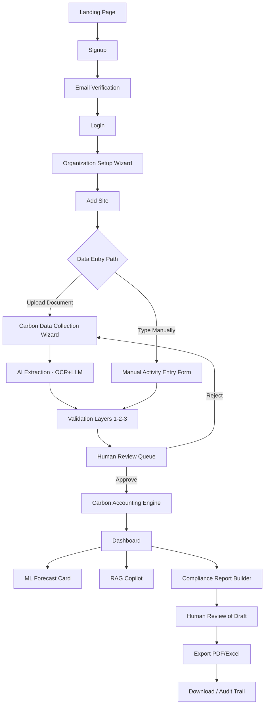

### Stage-by-stage backend detail

| # | Stage | Frontend | Backend / DB / Queue action |
|---|---|---|---|
| 1 | Landing | Static marketing page | None |
| 2 | Signup | Form: email, password, org name | `POST /api/auth/signup` → validate → bcrypt hash → INSERT `users` (`PENDING_VERIFICATION`) + `organizations` → INSERT `auth_tokens` (`purpose=EMAIL_VERIFY`) → send email (sync, fire-and-forget) |
| 3 | Email Verification | "Check your inbox" screen | `POST /api/auth/verify-email` → validate token in `auth_tokens` → UPDATE `users.status='ACTIVE'` |
| 4 | Login | Form: email, password | `POST /api/auth/login` → verify bcrypt → issue JWT access (15 min) + refresh (7 day, httpOnly cookie) → INSERT `sessions` |
| 5 | Org Setup Wizard | 3-step: Company → Industry/Country → Reporting Year | `POST /api/organizations` → INSERT `organizations`, `organization_settings`, `reporting_periods` (seeded) |
| 6 | Add Site | Form: name, type, address | `POST /api/sites` → INSERT `sites` (scoped to `organization_id` from JWT) |
| 7a | Document Upload | Category grid → drag-drop | `POST /api/documents/upload-url` (pre-signed) → client PUTs to S3/MinIO → `POST /api/documents` → INSERT `documents` (`UPLOADED`) → enqueue `ai-queue` job `EXTRACT_DOCUMENT` |
| 7b | Manual Entry | Structured form (fuel type, qty, unit, dates) | `POST /api/activity-data/manual` → INSERT `documents` (`source=MANUAL`, status jumps straight to `EXTRACTED`) + `extracted_data` (`extraction_version=1`, no OCR/LLM involved) |
| 8 | AI Extraction | Status pill "Extracting…" (polled) | `aiWorker` picks job → LangGraph: OCR → Classify → Extract → Confidence → Persist → INSERT `extracted_data` → UPDATE `documents.status='EXTRACTED'` → enqueue Layer 1/2 (sync) |
| 9 | Validation | Flags shown in Review Queue | Layer 1/2 run synchronously in `core-api`; Layer 3 enqueued to `ai-queue` job `VALIDATE_LAYER3` → INSERT `document_audit_log` (per layer) |
| 10 | Human Review | Side-by-side review panel | `POST /api/documents/:id/approve` or `/reject` → UPDATE `documents.status` → INSERT `document_audit_log` (`HUMAN_REVIEW`) → on approve, enqueue `calc-queue` job `CALCULATE_RECORD` |
| 11 | Carbon Calculation | "Calculating…" shimmer | `calcWorker` → `IEmissionFactorProvider.resolveFactor()` → deterministic formula → INSERT `calculated_emissions` + `calculation_logs` → refresh `emissions_aggregates` |
| 12 | Dashboard | KPI cards, charts | `GET /api/dashboard/summary` reads only from `emissions_aggregates` |
| 13 | Forecast | Forecast card | `GET /api/forecast` → Core API → FastAPI `/predict` → `ml_predictions` cached read |
| 14 | RAG Copilot | Chat panel | `POST /api/copilot/query` → embed query → pgvector `ORDER BY embedding <=> $1` → LangChain chain → cited answer |
| 15 | Compliance Report | Report Builder | `POST /api/reports/:id/generate-draft` → `aiWorker` job `DRAFT_COMPLIANCE_SECTION` (LangGraph, narrative only) + numeric fields templated directly from `emissions_aggregates` |
| 16 | Export | Download button | `POST /api/reports/:id/finalize` → render PDF/Excel (sync) → INSERT `report_versions` |

---

## SECTION 2 — Authentication Flow

### 2.1 Signup

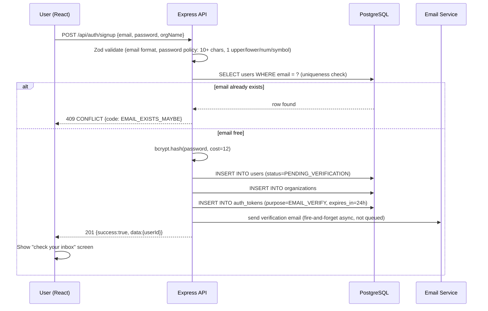

### 2.2 Login

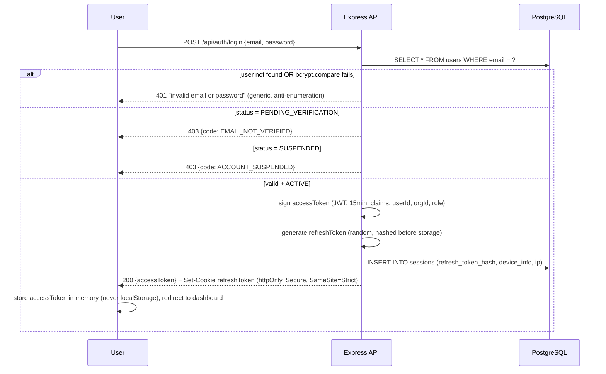

**Rate limiting:** 5 failed attempts / 15 min / account → 429 with `retry_after_seconds`, then captcha required on next attempt.

### 2.3 Forgot Password / Reset

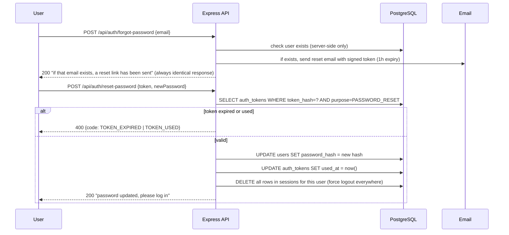

### 2.4 JWT Refresh (silent, on every access-token expiry)

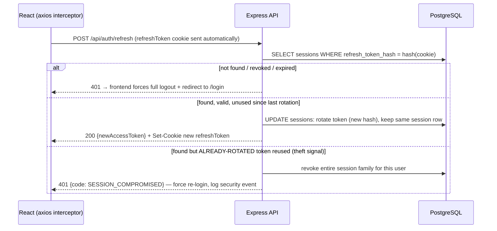

### 2.5 Session Expiry & Logout

| Trigger | Frontend behaviour | Backend action |
|---|---|---|
| Access token expires mid-session (15 min) | Axios interceptor catches 401 → silently calls `/auth/refresh` → retries original request once | See 2.4 |
| Refresh token expires (7 days idle) | Refresh fails → redirect to `/login` with "session expired, please log in again" | `sessions` row naturally expired, no action needed |
| User clicks "Logout" | Clear in-memory access token, redirect to `/login` | `POST /api/auth/logout` → DELETE current `sessions` row |
| User clicks "Logout of all devices" | Same, plus warning modal | `POST /api/auth/logout-all` → DELETE all `sessions` rows for `userId` |

**Permissions:** all auth endpoints are public except `/logout*` (requires valid access token). No role restriction — every role authenticates the same way; `SUPER_ADMIN` uses a fully separate route (`/api/admin/auth/login`) and JWT audience claim, never issuable via public signup.

---

## SECTION 3 — Organization Workflow

### 3.1 Create Organization (part of onboarding, cannot be skipped)

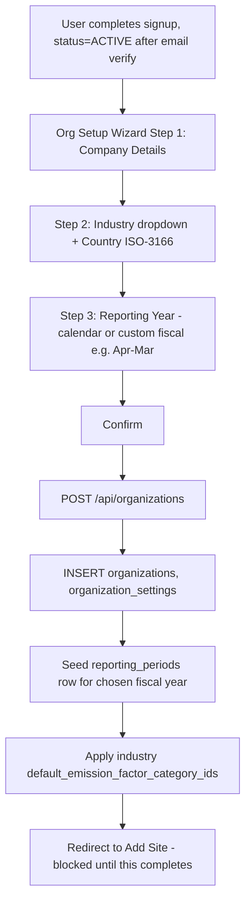

### 3.2 Update Organization / Settings

| Action | Frontend | Backend | DB | Notes |
|---|---|---|---|---|
| Edit company profile | Tabbed settings (Profile/Reporting/Preferences), inline save per tab | `PATCH /api/organizations/:id` | UPDATE `organizations` | Audit-logged (`audit_logs`) |
| Change industry (post data-collection) | Warning modal, must type "CONFIRM" | `PATCH .../` with `confirmed:true` flag | UPDATE `organizations.industry_id` | Blocked without confirm flag if `calculated_emissions` exist for org |
| Change reporting year | Same settings screen | `PATCH /api/organizations/:id/reporting-year` | UPDATE `reporting_periods` | 409 `REPORTING_PERIOD_LOCKED` if current period already locked |
| Delete organization | **Not exposed in v1** — Super Admin can only `SUSPEND` (soft) | `PATCH /api/admin/organizations/:id/status` | UPDATE `organizations.status='SUSPENDED'` | Hard delete never implemented — audit/compliance retention requirement |

### 3.3 Permissions
`ORG_ADMIN`: create/edit own org. `ORG_MEMBER`: read-only. `SUPER_ADMIN`: suspend/reactivate any org via Admin Console only (never edits org content).

### 3.4 Error Handling
| Error | HTTP | code |
|---|---|---|
| Invalid industry/country | 400 | `VALIDATION_ERROR` |
| Reporting year change with locked period | 409 | `REPORTING_PERIOD_LOCKED` |
| Non-admin attempts edit | 403 | `FORBIDDEN` |

---

## SECTION 4 — Site Workflow

### 4.1 Add / Edit / Deactivate Site

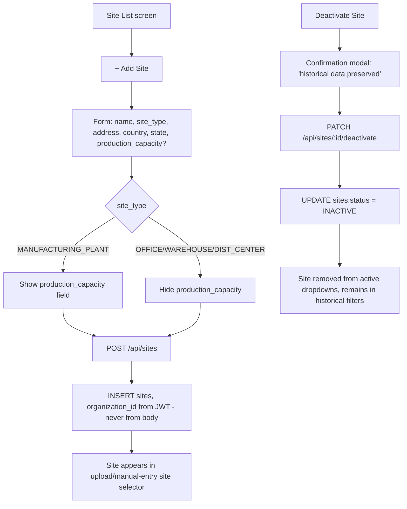

### 4.2 Plant / Site Dashboard

`GET /api/sites/:id/dashboard` → reads `emissions_aggregates WHERE site_id = ?` → returns scope 1/2/3 split + trend + "compare to other sites" data. Same aggregation table as the org-level dashboard (§10), just filtered.

### 4.3 Emission Aggregation Rule
Every `calculated_emissions` row carries a `site_id` OR is explicitly tagged **organization-level / shared** (a pseudo-site) — e.g., HQ business travel not attributable to one plant. This guarantees `SUM(site-level) + SUM(org-level) = org total` always reconciles — a documented acceptance-test invariant.

### 4.4 Validations & Edge Cases
| Case | Handling |
|---|---|
| Duplicate site name within org | 400, unique constraint on `(organization_id, name)` |
| Upload/manual-entry against `INACTIVE` site | 400 `SITE_INACTIVE` |
| Hard-delete attempt on site with data | 409 `CONFLICT`, guided to deactivate instead |
| Org with only 1 site | UI hides "compare sites" toggle |

---

## SECTION 5 — Carbon Data Collection Workflow (Detailed)

### 5.1 Full Wizard Flow

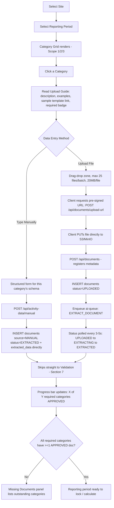

### 5.2 Document Category Taxonomy (drives which upload guide + schema is shown)

| Scope | Category | Required? | Example Docs | Manual-entry fields |
|---|---|---|---|---|
| 1 | Stationary Combustion | If site has combustion equipment | Diesel/LPG/Furnace Oil/Natural Gas bills | fuel_type, quantity, unit, purchase_date |
| 1 | Mobile Combustion | If site owns vehicles/generators | Generator logs, vehicle fuel logs | vehicle_type, fuel_type, quantity, unit |
| 1 | Fugitive Emissions | Optional (flagged if HVAC present) | Refrigerant top-up records | refrigerant_type, quantity_kg |
| 2 | Purchased Electricity | Required, every active site | Electricity bills | kwh_consumed, billing_period, grid_region |
| 2 | Renewable Energy | Optional | RECs, solar generation reports | renewable_kwh, certificate_id |
| 3 | Upstream Transport | If site receives inbound shipments | Transport challans, bills of lading | origin, destination, distance_km, weight_kg, transport_mode |
| 3 | Downstream Transport | If site ships outbound | Shipment invoices, courier bills | same shipment schema as above |
| 3 | Purchased Goods & Services | If procurement in scope | Purchase orders, supplier invoices | material_type, quantity, supplier_name |
| 3 | Waste | If site generates tracked waste | Waste disposal records | waste_type, quantity, disposal_method |
| 3 | Business Travel & Commuting | Optional, recommended | Employee travel bills | travel_mode, distance_km |

### 5.3 Document Status State Machine

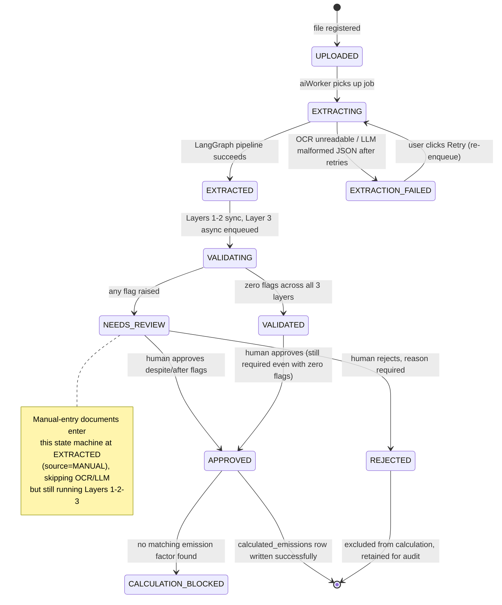

### 5.4 Feature Details
| Feature | Behaviour |
|---|---|
| **Progress tracking** | Per site+period: `GET /api/reporting-periods/:id/progress` returns `{category, requiredStatus, approvedCount}[]`. Progress bar = APPROVED count only, not merely uploaded. |
| **Missing document detection** | Derived server-side from site type + prior-period history; surfaced as a persistent sidebar banner with direct "upload now" deep links. |
| **Sample templates** | Each category has a downloadable CSV/XLSX template stored in object storage, linked from the upload guide. |
| **Versioning** | Re-uploading/reprocessing a document creates a **new** `extracted_data` row (`extraction_version` incremented) — the old one is never overwritten, full history preserved for audit. |
| **Replace existing document** | UI-level "replace" = upload new file + mark old `documents` row `status=REJECTED, reason='superseded'` — never a destructive delete. |
| **Multi-file upload** | Client uploads files in parallel (max 25/batch); each gets its own `documents` row and its own `EXTRACT_DOCUMENT` job — independent success/failure per file. |
| **Retry upload** | If `EXTRACTION_FAILED`, a "Retry" button re-enqueues the same `documents.id` — idempotent (does not create a duplicate row). |
| **Failed upload (network)** | Client-side resumable/chunked upload for files near 20MB; on total failure, file never reaches `POST /api/documents`, so no DB row is created — clean retry from scratch. |

### 5.5 Reporting Period Lock

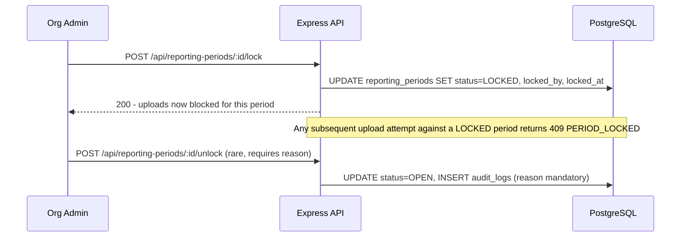

### 5.6 Validation (field-level, at upload time)
File type ∈ {PDF, JPG, PNG, XLSX, CSV} (server-side MIME sniff, not extension trust) · size ≤ 20MB · batch ≤ 25 files · category must belong to a valid scope · site must be `ACTIVE` · period must be `OPEN`.

### 5.7 Error Handling
| Failure | User-facing message | Backend code |
|---|---|---|
| Wrong file type | "This file type isn't supported. Upload PDF, JPG, PNG, XLSX or CSV." | 400 `INVALID_FILE_TYPE` |
| File too large | "File exceeds 20MB limit." | 400 `FILE_TOO_LARGE` |
| Upload to locked period | "This reporting period is locked." | 409 `PERIOD_LOCKED` |
| Corrupt/unreadable file | "File could not be read, please re-upload a clearer copy." | `EXTRACTION_FAILED` status |

---

## SECTION 6 — AI Data Collector Workflow (LangGraph Extraction Pipeline)

This is one of the platform's **two** LangGraph graphs (per the locked architecture). It runs inside `aiWorker` on the `ai-queue`, job type `EXTRACT_DOCUMENT`.

### 6.1 Graph Structure

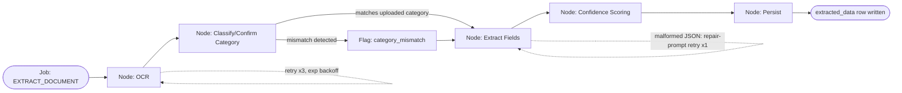

### 6.2 Sequence Diagram — Full Pipeline

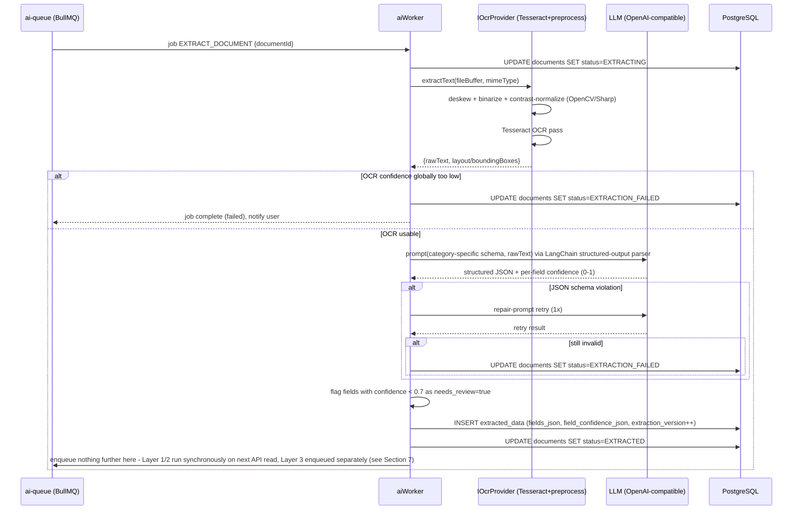

### 6.3 Extraction Schemas by Category (structured JSON shape)
| Category | Fields |
|---|---|
| Shipment/Transport | shipment_id, invoice_number, invoice_date, transport_mode, vehicle_type, distance_km, weight_kg, origin, destination, pickup_date, delivery_date |
| Electricity Bill | consumer_number, billing_period_start/end, kwh_consumed, tariff_rate, grid_region, renewable_percentage |
| Fuel Bill | fuel_type, quantity, unit, purchase_date, supplier_name, invoice_number |
| Waste Document | waste_type, quantity, unit, disposal_method, disposal_date |

Every field ships with a `confidence` (0–1) and a `source_bounding_box` (page + coordinates) so the review UI can highlight exactly where a value came from.

### 6.4 Input / Output / Errors per Node
| Node | Input | Output | Possible Errors | Retry Policy |
|---|---|---|---|---|
| OCR | file buffer, mimeType | raw text + layout | unreadable scan, timeout | 3x exponential backoff, then `EXTRACTION_FAILED` |
| Classify | raw text | confirmed/mismatched category | LLM timeout | inherits job-level retry |
| Extract | raw text + category schema | structured JSON + confidence | malformed JSON | 1x repair-prompt retry |
| Confidence Scoring | structured JSON | per-field scores | none (deterministic post-processing) | n/a |
| Persist | scored JSON | `extracted_data` row | DB write failure | job-level retry (idempotent — new version row, never overwrite) |

### 6.5 Fallback & Human Review
If the pipeline exhausts all retries, `documents.status = EXTRACTION_FAILED` with a support-facing error code; user sees "Retry" or can switch to **Manual Entry** (§5.1 path B) for that specific document instead of being blocked. Every successful extraction — regardless of confidence — still lands in the Human Review queue (§8); the AI never writes directly to a state that skips review.

---

## SECTION 7 — Validation Workflow (Three Layers)

### 7.1 Layer Sequence

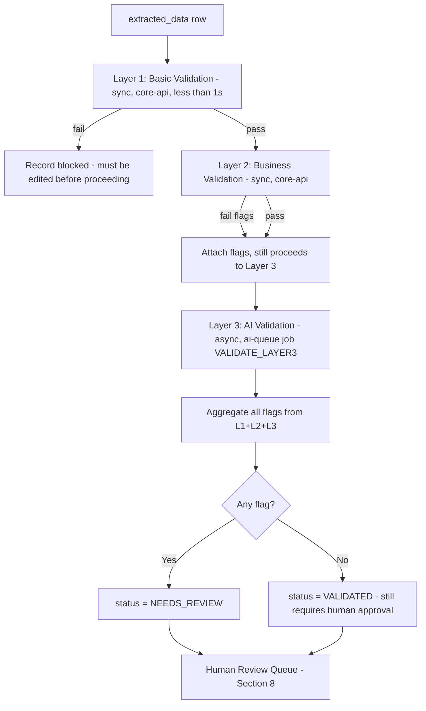

### 7.2 Layer 1 — Basic Validation (deterministic, rule-based)
| Check | Example | Action | Severity |
|---|---|---|---|
| Missing required field | Fuel bill missing quantity/unit | Block, must edit | Hard block |
| Invalid format | Non-numeric value in quantity field | Block | Hard block |
| Duplicate upload | Same invoice_number + supplier + date twice | Flag | Warning |
| Required category empty | Category marked required, zero approved docs | Flag on progress bar | Info |

### 7.3 Layer 2 — Business Validation (deterministic, domain rules)
| Check | Example | Severity |
|---|---|---|
| Fuel-vehicle mismatch | Vehicle = "Electric Truck" but fuel_type = "Diesel" | Warning |
| Impossible geography | Origin = Destination but distance_km = 1800 | Warning |
| Capacity violation | Shipment weight exceeds vehicle max capacity | Warning |
| Date logic | delivery_date < pickup_date | Hard block |
| Unit sanity range | kWh value is a statistical outlier vs. site history | Warning |

### 7.4 Layer 3 — AI Validation (LLM reasoning, async)
**Output vocabulary is locked to exactly these four values — never approve/reject:**

| Output | Meaning | Example |
|---|---|---|
| `OK` | No concerns | Value consistent with history and cross-document data |
| `SUSPICIOUS` | Statistically unusual, needs a human look | Fuel bill 50x larger than site's monthly average |
| `LIKELY_ERROR` | High-confidence probable mistake | OCR likely misread "1,OOO" as needing to be "1,000" |
| `MISSING_INFO` | Referenced but absent supporting data | Invoice says "per attached manifest," no manifest uploaded |

Every flag **must** carry a plain-language `explanation` string (e.g., *"This fuel bill's quantity is 42x higher than this site's 6-month average, which suggests a possible unit error (liters vs. kiloliters)."*) — a bare flag code is never shown to a reviewer.

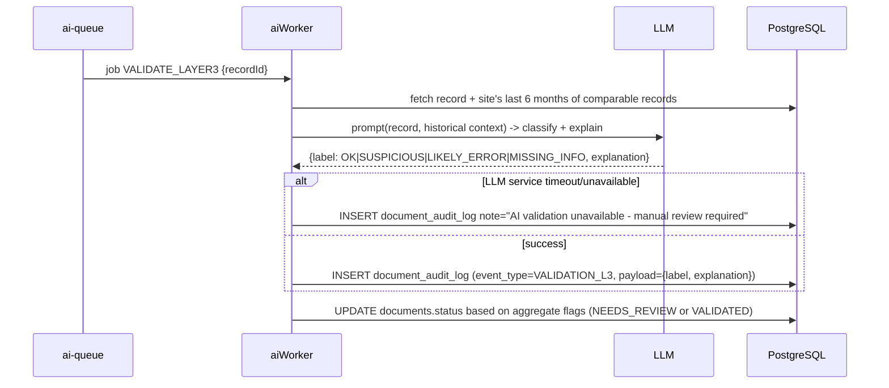

### 7.5 Business Rules
- A Layer 1 failure **cannot** be approved as-is — must be edited and re-validated.
- A record with only Layer 3 flags **can** be approved by a human who judges it a false positive — the AI never blocks, only informs.
- Editing any field re-triggers Layers 1→2→3 on the edited record (edits are not exempt).

---

## SECTION 8 — Human Review Workflow

### 8.1 Why Human Approval Exists (state this explicitly in the UI copy and in any viva/interview answer)
An "audit-ready" number is only defensible if a human, not just an algorithm, is demonstrably in the loop. Layer 3 AI *informs* — it never has the authority to *decide*. This is the platform's core trust mechanism and directly satisfies BRSR/CSRD-style audit expectations.

### 8.2 State Diagram

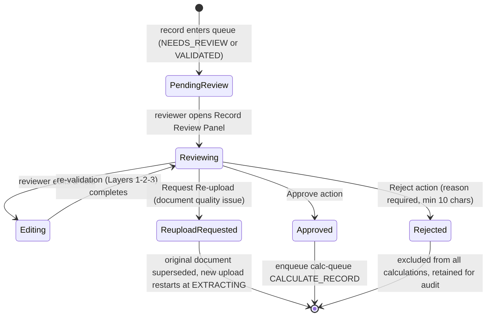

### 8.3 Review Screen Behaviour
| Element | Behaviour |
|---|---|
| Layout | Side-by-side: original document/image preview (left) + extracted/editable fields (right) |
| Confidence indicator | Color-coded per field: green ≥0.9, yellow 0.7–0.9, red <0.7 (color never the sole indicator — icon/text accompanies) |
| Flags panel | All Layer 1/2/3 flags listed with plain-language explanations |
| Actions | Approve / Edit & Re-validate / Reject — always visible, never hidden behind a menu |
| Bulk approve | Only for records with **zero** flags across all layers; server re-validates this server-side before bulk-approving (never trusts client-side filtering) |

### 8.4 API Calls
| Method | Endpoint | Effect |
|---|---|---|
| GET | `/api/review-queue` | List pending records, filterable by flag severity/site/category |
| POST | `/api/documents/:id/approve` | → `document_audit_log` (HUMAN_REVIEW) → `documents.status=APPROVED` → enqueue `calc-queue` `CALCULATE_RECORD` |
| POST | `/api/documents/:id/reject` | Requires `reason` (min 10 chars) → `status=REJECTED`, never deleted |
| PATCH | `/api/documents/:id/extraction` | Edit field → re-triggers Layers 1-2-3 |
| POST | `/api/review-queue/bulk-approve` | Server re-checks zero-flag condition per record before applying |

### 8.5 Concurrency Edge Case
Two reviewers editing the same record simultaneously → optimistic locking via a `version` field on `extracted_data`; the second submitter receives "this record was updated, please refresh" rather than silently overwriting.

---

## SECTION 9 — Carbon Accounting Workflow (Deterministic Engine)

### 9.1 Provider-Abstracted Architecture (locked decision from Scope Rationalization v1.2)

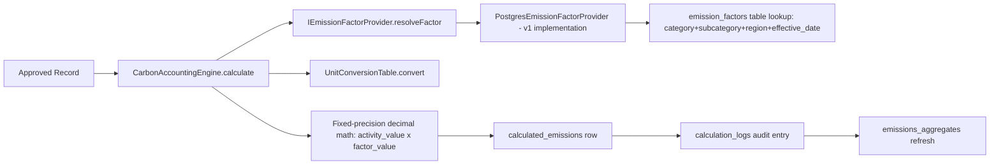

The engine itself never imports an LLM client (ESLint `no-restricted-imports` enforced at compile time) and never makes a network call except to Postgres via its repository — this is what makes the resulting number reproducible and legally defensible.

### 9.2 End-to-End Sequence

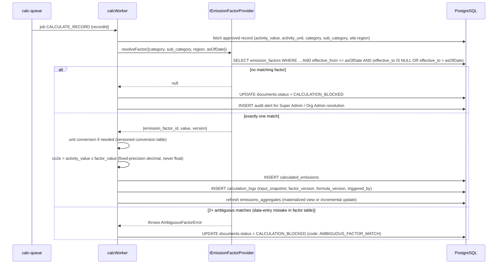

### 9.3 Scope-Specific Decision Trees

**Scope 1 (direct emissions):**
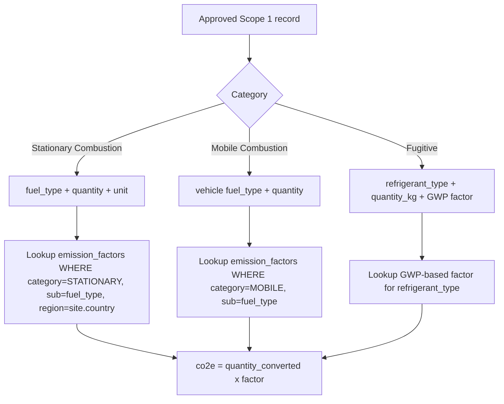

**Scope 2 (purchased energy) — location-based vs market-based:**
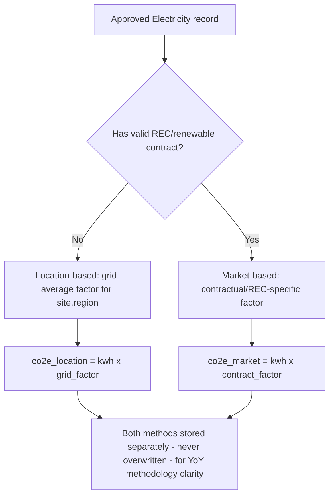

**Scope 3 (value chain) — category-routed:**
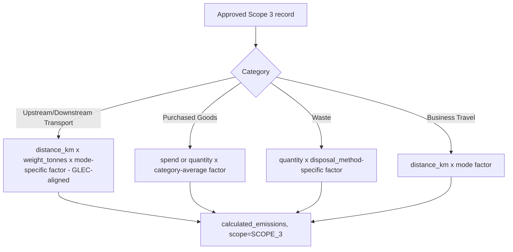

### 9.4 Business Rules (exhaustive)
1. Once a `reporting_period` is `LOCKED`, calculations for it are frozen; a later emission-factor update does **not** retroactively change locked numbers unless an `ORG_ADMIN` explicitly force-unlocks (full audit trail of "why" required).
2. Only `SUPER_ADMIN` can add/edit emission factors; edits are **additive** — a new version row with `effective_from`, never an overwrite of history.
3. Market-based Scope 2 is only used if valid RECs/contracts are on file; otherwise location-based is the default — never silently substituted the other way.
4. A record with **no** matching factor is never silently skipped — it sets `CALCULATION_BLOCKED` and raises an ops alert; silently dropping data would corrupt totals.
5. Two "current" factor versions matching the same date range is a data-entry bug, not a system choice to resolve silently — engine throws `AmbiguousFactorError` rather than guessing.
6. Determinism is a hard non-functional requirement: identical inputs + identical factor version must produce a bit-for-bit identical `co2e_value` on every run (fixed-precision decimal arithmetic, not native floats) — this is CI-tested (see TRD §15 determinism test).

### 9.5 Manual Recalculation

```mermaid
sequenceDiagram
    participant OA as Org Admin
    participant A as Express API
    participant Q as calc-queue
    participant W as calcWorker

    OA->>A: POST /api/reporting-periods/:id/recalculate
    A->>A: validate period is OPEN or force-unlocked
    A->>Q: enqueue RECALCULATE_PERIOD {periodId}
    Q->>W: process job
    W->>W: re-run CALCULATE_RECORD pipeline for every APPROVED record in scope
    W->>W: write NEW calculation_logs entries - never deletes old ones, full history preserved
    W-->>A: complete, dashboard aggregate refresh triggered
```

### 9.6 Database Writes Summary
| Table | Operation | When |
|---|---|---|
| `calculated_emissions` | INSERT (or update `co2e_value_kg` on recalculation, new `calculation_logs` regardless) | On approval / manual recalculation |
| `calculation_logs` | INSERT (immutable, never updated) | Every calculation run, including recalculations |
| `emissions_aggregates` | UPSERT (materialized rollup) | After every `calculated_emissions` write |
| `documents` | UPDATE `status` | `APPROVED` → stays `APPROVED`; or → `CALCULATION_BLOCKED` |

---

## SECTION 10 — Dashboard Workflow

### 10.1 Load Sequence

```mermaid
sequenceDiagram
    participant U as React Dashboard
    participant A as Express API
    participant D as PostgreSQL (emissions_aggregates)

    U->>A: GET /api/dashboard/summary?periodId=&siteIds=&scope=
    A->>A: inject organization_id from JWT (never trust client param)
    A->>D: SELECT FROM emissions_aggregates WHERE organization_id=? AND ...filters
    D-->>A: pre-aggregated rows (never queries raw calculated_emissions directly)
    A-->>U: {totalCo2e, pctChangeVsPrior, scopeSplit, intensityKpi?}
    U->>U: render KPI cards (skeleton until data arrives)
    par parallel widget fetches
        U->>A: GET /api/dashboard/trend
        U->>A: GET /api/dashboard/site-comparison
        U->>A: GET /api/dashboard/hotspots
    end
```

### 10.2 Widgets & Behaviour
| Widget | Data source | Behaviour |
|---|---|---|
| KPI cards | `/dashboard/summary` | Total CO2e, % change vs prior period, Scope 1/2/3 split, Emissions Intensity (hidden entirely if no production/revenue denominator supplied — never shown as misleading zero) |
| Scope breakdown | `/dashboard/summary` | Donut/stacked bar, drillable to category level |
| Trend chart | `/dashboard/trend` | Monthly/quarterly line, filterable by scope/site/category |
| Site comparison | `/dashboard/site-comparison` | Ranked bar chart, click-through to Site Dashboard (§4.2); paginates beyond 100 sites |
| Hotspot panel | `/dashboard/hotspots` | Top-N contributing categories/sites/sources for selected period |
| Forecast card | `/api/forecast` | See §11 |
| Filters | Site (multi-select), reporting period, scope, category — combine with AND logic, shareable via URL query params |
| Export | `POST /api/dashboard/export` | PDF snapshot or Excel data dump of current filtered view |

### 10.3 Business Rule
Dashboard **only** ever reflects `APPROVED` + calculated data — never partially-reviewed or rejected records — so numbers on screen always reconcile exactly with what an exported compliance report would show (this is a CI-tested reconciliation invariant).

### 10.4 Caching / Refresh
`emissions_aggregates` is refreshed synchronously as part of the `calcWorker`'s `CALCULATE_RECORD`/`RECALCULATE_PERIOD` jobs (materialized-view refresh or incremental upsert). If a dashboard load races a very recent calculation, it shows a "data updating, refresh in a moment" notice rather than a stale number with no explanation.

### 10.5 Error / Empty States
| Condition | UI |
|---|---|
| New org, zero calculated data | "Once you approve your first data in the Review Queue, your dashboard will populate here" |
| Period partially complete | Period labelled "in progress," not implied as final |
| Widget slow/failed | That widget alone shows a skeleton/error — never blocks the rest of the page |

---

## SECTION 11 — Machine Learning Workflow (Carbon Forecasting)

### 11.1 End-to-End Flow

```mermaid
flowchart TD
    A[calculated_emissions - monthly aggregates] --> B[Feature Engineering]
    B --> C[lag features 1/3/6mo, seasonality, transport-mode mix, fuel volume, shipment volume]
    C --> D{>= 6 months approved history?}
    D -->|No| E[scikit-learn trailing-average/trend baseline - labeled 'basic trend estimate' in UI]
    D -->|Yes| F[XGBoost regressor - train/validation time-based split]
    F --> G[Evaluate: MAPE + RMSE vs held-out recent periods]
    G --> H{Beats currently-deployed model's MAPE?}
    H -->|No| I[Keep previous model version active, alert ML ops]
    H -->|Yes| J[Promote new model version - ml_models row, status=DEPLOYED]
    J --> K[FastAPI /predict endpoint serves it]
    E --> K
    K --> L[Core API GET /api/forecast]
    L --> M[Dashboard Forecast Card]
```

### 11.2 Cold-Start / Synthetic Data Strategy (locked decision v1.2)
Because a real deployment needs 6 real months before XGBoost activates, a dedicated **demo organization** is seeded via `seedSyntheticHistory.ts`: 12–18 months of plausible `calculated_emissions` rows generated with trend + seasonality + noise, derived from the *actual* unit ranges seen in real extracted documents (so synthetic numbers stay internally consistent with the real emission-factor table). This data is scoped only to the demo org and never mixed into a real customer's numbers — used specifically to demonstrate the full XGBoost path in a viva/interview setting.

### 11.3 Training Sequence

```mermaid
sequenceDiagram
    participant Sched as Scheduled Job (monthly)
    participant A as Core API
    participant F as FastAPI ML Service
    participant D as PostgreSQL (read replica if available)

    Sched->>A: trigger internal/ml/train {organizationId}
    A->>F: POST /train {orgId}
    F->>D: extract historical aggregates + engineer features
    F->>F: time-based train/validation split (never random - avoids leakage)
    F->>F: train XGBoost, cross-validate
    F->>F: compute MAPE/RMSE vs held-out window
    alt beats current deployed version
        F->>F: serialize model artifact, store in object storage
        F->>D: INSERT ml_models (version, metrics, status=DEPLOYED), mark prior RETIRED
    else does not beat current
        F->>D: INSERT ml_models (status=EVALUATING, rejected) - previous stays DEPLOYED
    end
```

### 11.4 Prediction Sequence

```mermaid
sequenceDiagram
    participant U as Dashboard
    participant A as Core API
    participant F as FastAPI /predict

    U->>A: GET /api/forecast?siteId=
    A->>A: check org has >=6mo approved history
    alt insufficient history
        A-->>U: {status: INSUFFICIENT_HISTORY, monthsAvailable: X}
        U->>U: show "Forecasting unlocks after 6 months... you currently have X" + progress bar
    else sufficient
        A->>F: POST /predict {features}
        F-->>A: {predicted_co2e, confidence_score, feature_importance}
        A-->>U: forecast payload
        U->>U: render Forecast Card: current vs predicted, confidence badge (High/Med/Low), "why this prediction" expandable
    end
```

### 11.5 Hard Rule
Forecasts are clearly labeled **predictions, not compliance figures** and must never appear inside an exported compliance report (§13) — only on the internal dashboard. A forecast recalculates whenever new actuals are approved for the most recent period.

### 11.6 Failure / Fallback
| Failure | Behaviour |
|---|---|
| FastAPI unavailable | Core API returns graceful "forecast temporarily unavailable"; dashboard hides the card rather than showing broken UI |
| Prediction wildly outside historical bounds | Sanity-check guard flags internally for ML-ops review, never shown unguarded to the user |
| One-off spike in training data (e.g. emergency generator use) | Feature engineering includes basic outlier-dampening so it doesn't permanently skew future forecasts |

---

## SECTION 12 — RAG Workflow (Sustainability Copilot)

**Locked v1 scope:** knowledge base = GLEC + GHG Protocol + BRSR + ESG Standards + ISO 14064 reference material **only**. No company-uploaded documents, no per-tenant vector filtering, no query-intent classifier needed in v1. This uses a **plain LangChain retrieval chain** — not LangGraph.

### 12.1 Ingestion (offline/scheduled, Super Admin only)

```mermaid
flowchart TD
    A[Source docs: GLEC, GHG Protocol, BRSR, ESG, ISO PDFs] --> B[Chunk: ~500-800 tokens, ~15% overlap]
    B --> C[Embed each chunk - OpenAI-compatible embeddings API]
    C --> D[INSERT kb_documents + kb_chunks with pgvector embedding column]
    D --> E[Ready for retrieval - same content served to every tenant]
```

### 12.2 Query Sequence

```mermaid
sequenceDiagram
    participant U as User (Chat Panel)
    participant A as Core API
    participant D as PostgreSQL + pgvector
    participant L as LLM

    U->>A: POST /api/copilot/query {question, sessionId?}
    A->>A: input length capped at 2000 chars
    A->>L: embed(question)
    L-->>A: query vector
    A->>D: SELECT kb_chunks ORDER BY embedding <=> $queryVector LIMIT 5
    D-->>A: top-5 chunks (global KB, no tenant filter needed in v1)
    A->>A: assemble context (chunks + recent conversation history for this session)
    A->>L: prompt: "answer ONLY from provided context, cite source, say 'I don't have enough information' if context is insufficient"
    L-->>A: answer + which chunks were used
    A->>D: INSERT chat_messages (role=ASSISTANT, content, citations_json)
    A-->>U: streamed token-by-token answer + clickable citation chips
```

### 12.3 Behaviour Details
| Aspect | Rule |
|---|---|
| Chunking | ~500–800 tokens, ~15% overlap to preserve context across boundaries |
| Retrieval | Top-k=5 pgvector cosine/L2 similarity search |
| Prompt design | LLM instructed to answer only from context; explicit "I don't know" path if no chunk clears the similarity threshold |
| Citations | Every factual claim has a clickable citation chip → shows source excerpt |
| Conversation memory | Retained per `chat_sessions` row for contextual follow-ups ("and what about Scope 1?") |
| Numeric answers | **Never** independently computed by the LLM — if a question needs a number about the org's own data, that's an explicit Phase-2 feature (structured query, not RAG); v1 copilot answers only from the static knowledge base |

### 12.4 Failure / No-Results
| Case | Handling |
|---|---|
| No chunk above similarity threshold | "I don't have enough information to answer that confidently" — never fabricates |
| LLM/DB unavailable | "Copilot is temporarily unavailable, please try again shortly" |
| Question outside sustainability domain | Politely declines, redirects to intended scope |
| Ambiguous framework reference ("is this compliant?") | Clarifying question: "compliant with which framework — BRSR or our internal summary?" |

---

## SECTION 13 — Compliance Agent Workflow

**This is the platform's second and final LangGraph graph.** Runs in `aiWorker`, job type `DRAFT_COMPLIANCE_SECTION`.

### 13.1 The Hard Rule (state this before anything else, every time this feature is discussed)
> **The LLM writes narrative text only. The Carbon Accounting Engine (§9) is the sole source of every numeric value that appears in a report. Numeric fields are inserted via template variables populated directly from `calculated_emissions`/`emissions_aggregates` — never asked of the LLM as free text, ever.**

### 13.2 Workflow

```mermaid
flowchart TD
    A[User selects framework: BRSR / ESG Summary + reporting period] --> B{All required numeric data calculated for period?}
    B -->|No| C[Block generation, list exactly what's missing]
    B -->|Yes| D[For each report section]
    D --> E{Field type?}
    E -->|Numeric| F[Template engine pulls DIRECTLY from calculated_emissions/emissions_aggregates - ZERO LLM calls on this path]
    E -->|Narrative| G[LangGraph: assemble org context + prior-year answer + framework guidance]
    G --> H[LLM drafts narrative text ONLY]
    F --> I[Assemble Report Draft]
    H --> I
    I --> J[Every section tagged 'AI-drafted - pending review']
    J --> K[Human Review Screen]
    K -->|Edit| K
    K -->|Approve section| L{All sections approved?}
    L -->|No| K
    L -->|Yes| M[POST /api/reports/:id/finalize]
    M --> N[Render PDF + Excel]
    N --> O[INSERT report_versions - immutable snapshot]
```

### 13.3 Sequence Diagram

```mermaid
sequenceDiagram
    participant U as Sustainability Manager
    participant A as Core API
    participant Q as ai-queue
    participant W as aiWorker (LangGraph)
    participant L as LLM
    participant D as PostgreSQL

    U->>A: POST /api/reports/:id/generate-draft
    A->>D: check all required numeric data exists for period
    alt data incomplete
        A-->>U: 400 {missingItems: [...]}
    else complete
        A->>Q: enqueue DRAFT_COMPLIANCE_SECTION per narrative section (independent, parallel jobs)
        loop each narrative section
            Q->>W: job {sectionKey}
            W->>D: fetch org context, hotspots, prior-year answer (if any)
            W->>L: prompt (context only, NO numeric generation permitted by design)
            L-->>W: narrative draft text
            W->>D: INSERT report_sections (ai_generated=true, status=AI_DRAFTED)
        end
        A->>D: numeric sections populated same-request, direct DB read, no queue needed
        A-->>U: report shell ready, sections stream in as they complete
    end
```

### 13.4 Human Review & Finalize
| Rule | Detail |
|---|---|
| No un-reviewed section can finalize | `POST /finalize` returns 400 listing outstanding `AI_DRAFTED` sections if any remain |
| Numeric fields are read-only in the UI | Rendered directly from the engine with a "view calculation detail" link — not editable text |
| Stale-data guard | If underlying numbers change after a narrative section was drafted (late correction), affected sections are flagged "may need review — underlying data changed" |
| Section-level failure isolation | One narrative section failing to draft (`DRAFT_FAILED`) never blocks the others — manual textarea fallback provided |

### 13.5 Export & Versioning
`POST /api/reports/:id/finalize` → validate all sections approved → render PDF (fixed template per framework) + Excel (full numeric detail table) → **one final consistency check**: numeric fields re-read fresh from `calculated_emissions` at render time → store both files in object storage → `INSERT report_versions` (immutable, never mutated — corrections create a new version, never edit history).

### 13.6 CI-Testable Acceptance Criteria
- No compliance report finalizes with any un-reviewed AI-drafted section.
- Every numeric value in an exported report is byte-identical to its corresponding `calculated_emissions` figure (automated reconciliation test).
- Static analysis / prompt review confirms the narrative-drafting prompt contains no code path by which the LLM could output a number not already provided as fixed context.

---

## SECTION 14 — Admin Workflow (Super Admin Console)

### 14.1 Scope
Internal-only console, separate route/subdomain, separate JWT audience claim, shorter session timeout than client-facing sessions.

```mermaid
flowchart TD
    A[Super Admin Login - isolated route] --> B[Admin Console]
    B --> C[Organizations: search/filter, view read-only, suspend/reactivate]
    B --> D[Sites: cross-org search, support use]
    B --> E[Users: cross-org search, force-reset password, deactivate]
    B --> F[Documents: cross-org search - respects read-only+logged-access policy]
    B --> G[AI Logs: searchable, input/output/latency/token-cost per call]
    B --> H[Reports: cross-org list for support/audit]
    B --> I[Emission Factors: add new version - never overwrite - source citation mandatory]
    B --> J[Feature Flags: enable/disable framework, toggle Layer 3 platform-wide, confidence thresholds]
    B --> K[Audit Logs: full platform trail, incl. cross-tenant access with mandatory reason field]
```

### 14.2 Cross-Tenant Access Rule
Any Super Admin view into a specific organization's *detailed* data requires a `reason` field before opening it, and every such view is written to `audit_logs` with `is_cross_tenant_access=true`. Metadata-level listing (org name, status, site count) does not require a reason; opening an org's actual documents/reports does.

### 14.3 Key Actions & Confirmation
| Action | Confirmation UX |
|---|---|
| Suspend organization | Modal, reason code required (Non-payment / ToS violation / Customer request / Other) |
| Add emission factor version | Form requires category, sub-category, region, unit, value, **source citation**, effective-from date — all mandatory, never optional |
| Deactivate user | Confirmation modal |
| Toggle feature flag | Immediate, logged, no typed-confirmation needed (reversible) |

### 14.4 Permission Enforcement
Every `/api/admin/*` route is behind a single shared middleware checking the `SUPER_ADMIN` role claim — not per-route ad hoc checks — so a non-Super-Admin JWT can never reach an admin route regardless of manipulation attempts (403, logged as a potential security event if repeated).

---

## SECTION 15 — Notification Workflow

**Locked decision:** notifications are **synchronous, fire-and-forget** in v1 (no dedicated worker/queue) — a deliberate simplification given expected volume; revisit only if load testing shows request-blocking becomes an issue.

### 15.1 Trigger Table
| Event | Channel | Recipient | Trigger point |
|---|---|---|---|
| Upload completed / extraction finished | In-app + email | Uploader | `aiWorker` after `EXTRACT_DOCUMENT` job completes |
| Validation failed / flags raised | In-app | Uploader, all `ORG_MEMBER`s with review rights | After Layer 1/2/3 aggregate |
| Review pending (reminder) | Email, scheduled | `ORG_ADMIN` | Configurable interval before reporting-period target close date |
| Forecast ready | In-app | Dashboard viewers | After `TRAIN_FORECAST_MODEL` promotes a new model |
| Report generated / draft ready | In-app + email | `ORG_ADMIN` | After `DRAFT_COMPLIANCE_SECTION` jobs all complete |
| Missing documents reminder | In-app banner + email | `ORG_ADMIN` | Scheduled cron, configurable days before period close |

### 15.2 Flow
```mermaid
sequenceDiagram
    participant W as Any Worker/API handler
    participant D as PostgreSQL
    participant E as Email Service

    W->>D: INSERT notifications {userId, type, message, is_read=false}
    W->>E: sendEmail - synchronous best-effort, not retried via queue in v1
    Note over W,E: Frontend polls / fetches GET /api/notifications for the bell icon
```

---

## SECTION 16 — API Call Flow (Cross-Cutting Reference)

For every major feature, the request travels: **React → Express (Core API) → [FastAPI, only for ML] → PostgreSQL → Response → Frontend Update.** FastAPI is only ever reached for two endpoints platform-wide (`/train`, `/predict`) — every other feature stays entirely inside the Node/TypeScript monorepo (Core API + `aiWorker` + `calcWorker`), per the locked architecture.

```mermaid
flowchart LR
    subgraph Browser
    A[React Component]
    end
    subgraph Node/TS Monorepo
    B[Express Route]
    C[Zod Validator]
    D[Controller]
    E[Service]
    F[Repository - TenantScopedRepository]
    G[aiWorker / calcWorker]
    end
    subgraph Python
    H[FastAPI /predict or /train]
    end
    I[(PostgreSQL + pgvector)]

    A -->|axios, Bearer JWT| B --> C --> D --> E --> F --> I
    E -.enqueue job.-> G --> I
    E -.ML only.-> H --> I
    I --> E --> D --> B -->|JSON envelope| A
```

### 16.1 Standard Response Envelope (every endpoint, always)
```json
// success
{ "success": true, "data": { }, "meta": { "page": 1, "pageSize": 20, "total": 134 } }
// failure
{ "success": false, "error": { "code": "PERIOD_LOCKED", "message": "...", "details": {} } }
```

### 16.2 Per-Feature API Map
| Feature | React calls | Express route | Touches FastAPI? | Primary tables |
|---|---|---|---|---|
| Auth | `/auth/*` | Public/JWT | No | `users`, `sessions`, `auth_tokens` |
| Organization | `/organizations/*` | ORG_ADMIN | No | `organizations`, `organization_settings` |
| Sites | `/sites/*` | ORG_ADMIN/MEMBER | No | `sites` |
| Data Collection | `/documents/*`, `/activity-data/manual` | ORG_MEMBER | No (enqueues `aiWorker`) | `documents`, `extracted_data` |
| Validation/Review | `/review-queue`, `/documents/:id/approve` | ORG_MEMBER | No (Layer 3 via `aiWorker`) | `document_audit_log`, `validation_rules` |
| Calculation | `/emissions/:id`, `/reporting-periods/:id/recalculate` | ORG_ADMIN (recalc) | No (`calcWorker`) | `calculated_emissions`, `calculation_logs`, `emission_factors` |
| Dashboard | `/dashboard/*` | ORG_MEMBER | No | `emissions_aggregates` |
| Forecast | `/forecast` | ORG_MEMBER | **Yes** — `/predict` | `ml_models`, `ml_predictions` |
| Copilot | `/copilot/query` | ORG_MEMBER | No (LLM direct + pgvector) | `kb_chunks`, `chat_messages` |
| Compliance | `/reports/*` | ORG_MEMBER/ADMIN | No (`aiWorker` for narrative only) | `compliance_reports`, `report_sections`, `report_versions` |
| Admin | `/admin/*` | SUPER_ADMIN | No | all tables, read-mostly |

---

## SECTION 17 — Database Update Flow (Per-Feature CRUD Map)

| Feature | Insert | Update | Delete | Transaction boundary | Audit entry |
|---|---|---|---|---|---|
| Signup | `users`, `organizations`, `auth_tokens` | — | — | single transaction (all-or-nothing) | — |
| Document upload | `documents` | — | — | single insert | `document_audit_log` (STATUS_CHANGE) on every transition |
| AI Extraction | `extracted_data` (new version row) | `documents.status` | — | per-job, idempotent | — |
| Validation | — | `documents.status` | — | Layer1+2 in one transaction; Layer3 separate | `document_audit_log` (VALIDATION_L1/L2/L3) |
| Human Review | — | `documents.status`, `extracted_data` (on edit) | — | optimistic-locked (`version` column) | `document_audit_log` (HUMAN_REVIEW) |
| Calculation | `calculated_emissions`, `calculation_logs` | `emissions_aggregates` (upsert) | — | single transaction per record | `calculation_logs` itself IS the audit trail |
| Recalculation | new `calculation_logs` rows | `calculated_emissions.co2e_value_kg` | **never** — old logs retained | bulk transaction, isolated per org | full history preserved by design |
| Emission factor edit | new `emission_factors` version row | — | **never overwrites** | single insert | `audit_logs` |
| Report finalize | `report_versions` | `compliance_reports.status`, `report_sections.status` | — | single transaction; rollback entirely on render failure | `audit_logs` |
| Org suspension | — | `organizations.status` | — | single update | `audit_logs` (reason mandatory) |

**Rollback policy:** any multi-step write that fails partway (e.g., PDF render succeeds but Excel render fails during report finalize) rolls back the entire finalize action — the report stays in its pre-finalize state, never a half-finalized/corrupted row. This is enforced by wrapping the finalize handler in a single DB transaction plus a check that both file-render steps succeeded before the `INSERT report_versions` commits.

---

## SECTION 18 — State Diagrams (Consolidated)

### 18.1 Document (already detailed in §5.3 — summarized here for cross-reference)
`UPLOADED → EXTRACTING → EXTRACTED → VALIDATING → NEEDS_REVIEW/VALIDATED → APPROVED/REJECTED → (CALCULATION_BLOCKED if factor missing)`

### 18.2 Extraction Job
```mermaid
stateDiagram-v2
    [*] --> Queued
    Queued --> Running: aiWorker picks up
    Running --> Succeeded: LangGraph completes all 5 nodes
    Running --> RetryingOCR: OCR node fails (up to 3x)
    Running --> RetryingLLM: LLM returns malformed JSON (1x repair prompt)
    RetryingOCR --> Running
    RetryingLLM --> Running
    RetryingOCR --> Failed: retries exhausted
    RetryingLLM --> Failed: repair retry also invalid
    Succeeded --> [*]
    Failed --> [*]: documents.status = EXTRACTION_FAILED
```

### 18.3 Calculation
```mermaid
stateDiagram-v2
    [*] --> Pending: record APPROVED
    Pending --> Resolving: calcWorker fetches factor
    Resolving --> Calculated: factor found, formula applied
    Resolving --> Blocked: no factor / ambiguous factor
    Calculated --> [*]: calculated_emissions + calculation_logs written
    Blocked --> [*]: CALCULATION_BLOCKED, ops alert raised
```

### 18.4 Report Generation
```mermaid
stateDiagram-v2
    [*] --> NotStarted
    NotStarted --> Generating: generate-draft triggered
    Generating --> AIDrafted: narrative sections complete
    AIDrafted --> UnderReview: human opens Report Builder
    UnderReview --> Approved: all sections approved
    UnderReview --> AIDrafted: section edited, re-flagged
    Approved --> Finalized: finalize action, PDF/Excel rendered
    Finalized --> [*]: immutable report_versions row created
```

### 18.5 Forecast (Model Lifecycle)
```mermaid
stateDiagram-v2
    [*] --> Training
    Training --> Evaluating: cross-validation complete
    Evaluating --> Deployed: beats current model's MAPE
    Evaluating --> Rejected: does not beat current model
    Deployed --> Retired: superseded by a later better model
    Rejected --> [*]
    Retired --> [*]
```

---

## SECTION 19 — Error Flows

| Failure | Where it's caught | User-facing message | Recovery |
|---|---|---|---|
| Upload failure (network) | Client-side chunked upload | "Upload interrupted, retrying…" then "please try again" | Resumable upload retry; no partial DB row created |
| OCR failure | `aiWorker` OCR node | "File could not be read, please re-upload a clearer copy" | 3x auto-retry, then manual retry button, or switch to Manual Entry path |
| LLM failure (extraction) | `aiWorker` Extract node | Same as above, or "extraction unavailable, try again shortly" | 1x repair-prompt retry, then `EXTRACTION_FAILED` |
| LLM failure (Layer 3 validation) | `aiWorker` Layer 3 job | Record proceeds to review queue with note "AI validation unavailable — manual review required" | Never blocks the pipeline |
| LLM failure (RAG) | Copilot query handler | "Copilot is temporarily unavailable, please try again shortly" | No retry queue — user re-asks |
| LLM failure (Compliance draft) | `aiWorker` compliance job | Section marked `DRAFT_FAILED`, manual textarea fallback | Other sections unaffected |
| API failure (5xx) | Global Express error handler | Generic "something went wrong" (never leaks stack trace) | Full stack logged server-side only |
| Database failure / connection lost | Repository layer | 500, generic message | Connection pool retry; transaction rolled back automatically |
| Validation failure (Layer 1) | Sync, core-api | Inline field-level error | Must edit before proceeding — hard block |
| Prediction failure (ML) | Core API → FastAPI call | Forecast card hidden, no error shown to end user | Sanity-check guard flags internally |
| Timeout (any LLM call) | Worker job wrapper | Job marked failed, retried per job-specific policy | See per-feature retry table above |
| Unauthorized access (wrong role) | Shared RBAC middleware | 403 Forbidden | Logged as security event if repeated |
| Session expired | Axios interceptor | Silent refresh attempt, then redirect to `/login` | See §2.4/2.5 |
| Network failure (frontend) | React Query retry | Cached last-known data shown with a "reconnecting…" badge | Auto-retry with backoff |
| Database lock / concurrent edit | Optimistic locking (`version` column) | "This record was updated, please refresh" | User re-fetches and re-applies edit |

---

## SECTION 20 — Sequence Diagrams (Index)

All sequence diagrams are embedded at point of use for context; this section is the navigation index so a developer can jump straight to the one they need.

| Flow | Location |
|---|---|
| Signup | §2.1 |
| Login | §2.2 |
| Forgot/Reset Password | §2.3 |
| JWT Refresh | §2.4 |
| Reporting Period Lock | §5.5 |
| AI Extraction (full LangGraph pipeline) | §6.2 |
| Layer 3 AI Validation | §7.4 |
| Carbon Calculation | §9.2 |
| Manual Recalculation | §9.5 |
| Dashboard Load | §10.1 |
| ML Training | §11.3 |
| ML Prediction | §11.4 |
| RAG Query | §12.2 |
| Compliance Draft Generation | §13.3 |
| Notification Dispatch | §15.2 |

---

## SECTION 21 — Edge Cases (Master List)

| Edge Case | Handling |
|---|---|
| Duplicate upload (same invoice twice) | Layer 1 flags on `invoice_number + supplier + date` match — not silently double-counted |
| Missing required documents at period close | Missing Documents panel blocks a clean "ready to calculate" state; period can still be locked manually by Org Admin with a warning |
| Wrong file format | Rejected client-side (extension) and server-side (MIME sniff) — never trusted on extension alone |
| Corrupt/unreadable PDF | `EXTRACTION_FAILED`, user-facing re-upload prompt |
| Very large file (>20MB) | Rejected at upload with clear size-limit message; batch capped at 25 files |
| Low OCR confidence (blurry scan) | Document marked `EXTRACTION_FAILED` rather than returning low-quality guesses — never a silent wrong value |
| Missing emission factor for a sub-type | `CALCULATION_BLOCKED`, surfaced to Super Admin/Org Admin — never silently skipped (would corrupt totals) |
| Invalid/unsupported scope-category combination | 400 at upload-category-selection step, before a file is even accepted |
| No historical data for forecasting | Forecast card disabled with "unlocks after 6 months… you have X" — never a misleading low-confidence guess |
| ML prediction failure / service down | Forecast card hidden entirely, not shown broken |
| OpenAI/LLM timeout (any feature) | Feature-specific graceful degradation — see §19 table, never a hung spinner indefinitely |
| Database lock / concurrent edit | Optimistic locking + "please refresh" message |
| Two emission factor versions ambiguously overlapping | Engine throws, `CALCULATION_BLOCKED (AMBIGUOUS_FACTOR_MATCH)` — never silently picks one |
| Site deactivated mid-reporting-period | Historical uploads/data remain valid; no new uploads accepted post-deactivation |
| User uploads to wrong category (e.g., electricity bill under "Diesel Bills") | AI Classify node flags category mismatch for human decision — never silently reclassified |
| Multi-invoice PDF (5 shipments in one file) | Extraction agent attempts logical split; if uncertain, flags whole document for manual review rather than merging incorrectly |
| Refresh token reused after rotation (theft signal) | Entire session family revoked, forced re-login, security event logged |
| Org Admin removes themselves as last admin | Blocked — "assign another admin first" |
| Org switches location-based → market-based Scope 2 mid-year | Both methods' results stored separately, never overwritten |
| Reporting period locked then factor updated | Locked-period numbers do NOT change unless Org Admin explicitly force-unlocks with audit trail |

---

## SECTION 22 — Complete System Flow (Master Diagram)

```mermaid
flowchart TD
    A[React + TypeScript SPA] -->|Bearer JWT, REST| B[Express + TypeScript Core API]
    B --> C[(PostgreSQL + pgvector\nsingle source of truth)]
    B --> D[carbon-engine module\npure TS, zero LLM imports]
    D --> C
    B -->|enqueue| E[ai-queue]
    B -->|enqueue| F[calc-queue]
    E --> G[aiWorker]
    F --> H[calcWorker]
    G -->|LangChain.js + LangGraph.js| I[OpenAI-compatible LLM]
    G --> C
    H --> D
    H -->|internal REST, /predict /train only| J[FastAPI + XGBoost + scikit-learn\nsole Python service]
    J --> C
    G -.pgvector similarity search.-> C
    C --> B
    B --> A
    B --> K[Object Storage\nS3/MinIO - raw files]

    subgraph "Two Workers Only"
    G
    H
    end

    subgraph "Two LangGraph Graphs Only"
    L[AI Extraction Graph - Section 6]
    M[Compliance Draft Graph - Section 13]
    end
    G -.runs.-> L
    G -.runs.-> M
```

**Reading this diagram:** everything left of the dotted "Two Workers" boundary is synchronous request/response (Express, carbon-engine, dashboard reads). Everything inside it is asynchronous, queued, retryable. FastAPI is the only non-TypeScript runtime in the entire platform, reached only for machine-learning inference/training — never for auth, documents, or compliance data, matching the non-negotiable rule this platform was designed around from the TRD.

---

*End of Functional Workflow Specification. This document, together with the PRD (what/why) and TRD (how/schema/infra) and the Scope Rationalization v1.2 (locked simplifications), is the complete implementation reference set for Carbon OS.*
