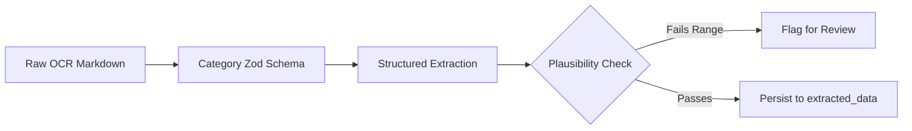

# CarbonIQ — Final Year Project Technical Viva Master Guide
**Authoritative Architectural & Theoretical Deep Dive for Engineering Viva / Defense**

---

## Table of Contents
1. [Executive Summary & Core Value Proposition](#1-executive-summary--core-value-proposition)
2. [End-to-End System Architecture](#2-end-to-end-system-architecture)
3. [Document Ingestion & Storage Pipeline](#3-document-ingestion--storage-pipeline)
4. [OCR & Vision Processing Layer (Mistral AI Vision)](#4-ocr--vision-processing-layer-mistral-ai-vision)
5. [Structured Extraction & OCR Graph Pipeline](#5-structured-extraction--ocr-graph-pipeline)
6. [Classification & Activity Record Construction](#6-classification--activity-record-construction)
7. [Authoritative Carbon Calculation Engine](#7-authoritative-carbon-calculation-engine)
8. [Emission Factor Resolution & Datasets](#8-emission-factor-resolution--datasets)
9. [Strategy Pattern & Calculation Strategy Registry](#9-strategy-pattern--calculation-strategy-registry)
10. [Dimensional Validation & Safety Gates](#10-dimensional-validation--safety-gates)
11. [Human-in-the-Loop Review Workspace](#11-human-in-the-loop-review-workspace)
12. [PostgreSQL Carbon Accounting Ledger & Audit Trail](#12-postgresql-carbon-accounting-ledger--audit-trail)
13. [RAG (Retrieval-Augmented Generation) Sustainability Copilot](#13-rag-retrieval-augmented-generation-sustainability-copilot)
14. [RAG Knowledge Base & Regulatory Standards](#14-rag-knowledge-base--regulatory-standards)
15. [ML Forecasting & Enterprise Ladder Engine](#15-ml-forecasting--enterprise-ladder-engine)
16. [Tri-Engine Architectural Distinction (Carbon Engine vs RAG vs ML)](#16-tri-engine-architectural-distinction-carbon-engine-vs-rag-vs-ml)
17. [End-to-End Real Document Execution Trace (Scope 3 Freight Waybill)](#17-end-to-end-real-document-execution-trace-scope-3-freight-waybill)
18. [BRSR (Business Responsibility & Sustainability Reporting) Generator](#18-brsr-business-responsibility--sustainability-reporting-generator)
19. [Enterprise Security, Authentication & Multi-Tenancy](#19-enterprise-security-authentication--multi-tenancy)
20. [Asynchronous Queues & Background Workers (BullMQ + Redis)](#20-asynchronous-queues--background-workers-bullmq--redis)
21. [Comprehensive Viva Examination Questions & Answers (50+ Categorized)](#21-comprehensive-viva-examination-questions--answers-50-categorized)
22. [Defense Against Critical & Trick Examiner Questions](#22-defense-against-critical--trick-examiner-questions)
23. [60-Second Elevator Pitch for Viva](#23-60-second-elevator-pitch-for-viva)
24. [3-Minute Technical Architecture Walkthrough](#24-3-minute-technical-architecture-walkthrough)
25. [System ASCII Architecture Blueprint](#25-system-ascii-architecture-blueprint)
26. [Technical Limitations, Edge Cases & Future Enhancements](#26-technical-limitations-edge-cases--future-enhancements)
27. [Glossary of Essential Terms](#27-glossary-of-essential-terms)
28. [Final Viva Quick-Reference Cheat Sheet](#28-final-viva-quick-reference-cheat-sheet)

---

## 1. Executive Summary & Core Value Proposition

### What Problem Does CarbonIQ Solve?
Corporate sustainability reporting and greenhouse gas (GHG) accounting are currently plagued by three systemic failures:
1. **Manual Data Entry Bottlenecks**: Carbon accountants spend hundreds of hours manually transcribing utility bills, fuel delivery receipts, air waybills, and supplier invoices into spreadsheets.
2. **Inconsistent & Non-Auditable Calculations**: Spreadsheets lack schema validation, dimensional unit verification, and strict factor versioning, leading to major accounting errors (e.g., confusing gallons with liters, or applying road freight factors to air cargo).
3. **AI Hallucination in Carbon Math**: Generic Generative AI models hallucinate emission numbers and invent arbitrary factors because LLMs are non-deterministic token predictors.

### What is CarbonIQ?
**CarbonIQ** is an enterprise-grade carbon accounting, compliance disclosure, and predictive intelligence platform. It merges **multi-modal Document AI** (for unstructured document ingestion), a **strictly deterministic Carbon Accounting Engine** (using approved statutory emission factors from DEFRA, EPA, GLEC, CEA, and IPCC), a **vector-grounded RAG copilot** (for regulatory compliance querying), and a **data-adaptive ML forecasting ladder** (for multi-horizon emission projections).

### Core Architectural Philosophy
> **"Probabilistic AI for Document Understanding & Natural Language; 100% Deterministic Arithmetic for Carbon Accounting; Vector RAG for Grounded Regulations; Statistical ML for Time-Series Projections."**

---

## 2. End-to-End System Architecture

```
User (Browser Client)
  │ (HTTPS / React + TailwindCSS SPA)
  ▼
API Gateway / Express REST Backend (`apps/core-api`)
  │ (JWT Auth, RBAC, Multi-Tenant Middleware)
  ├──► MinIO / S3 Object Storage (Raw PDFs, Invoices, Receipts)
  ├──► PostgreSQL Database (`packages/database` / Prisma ORM)
  └──► Redis BullMQ Queues (`ai-queue`, `calc-queue`)
         │
         ▼
AI Worker Background Processor (`apps/core-api/src/workers/ai.worker.ts`)
  ├──► Mistral AI Vision OCR Provider (`mistral-vision.provider.ts`)
  ├──► LangGraph-Style Extraction Pipeline (`extraction-graph.ts`)
  ├──► Canonical Activity Normalizer (`canonical-activity.normalizer.ts`)
  ├──► Unit Converter (`unit-converter.ts`)
  ├──► PostgreSQL Factor Provider (`emission-factor.provider.ts`)
  ├──► Strategy Registry (`strategies/strategy.registry.ts`)
  └──► Transactional Carbon Ledger (`calculated_emissions`, `calculation_logs`)
         │
         ├──► RAG Knowledge Base (`kb_documents`, `kb_chunks`, `pgvector`)
         ├──► ML Forecasting Service (`apps/ml-service` via FastAPI / Python)
         └──► Statutory BRSR PDF Generator (`brsr-pdf-generator.service.ts`)
```

### Complete Component Map
| Pipeline Stage | Implemented In (File) | Class / Service / Function | Input | Output | Database Table | Queue Involved | Why It Exists |
| :--- | :--- | :--- | :--- | :--- | :--- | :--- | :--- |
| **1. UI Upload** | `shipmind-ai/src/components/upload/UploadWizard.tsx` | `handleFileUpload()` | PDF / Image File | Multi-part form data | `documents` | None (Client UI) | Captures user file and initiates tenant upload |
| **2. Upload URL API** | `apps/core-api/src/modules/document/document.controller.ts` | `getUploadUrl()` | `filename`, `mimeType`, `size` | S3 Pre-signed URL | None | None | Eliminates backend memory bottlenecks via direct S3 streaming |
| **3. Document Ingestion** | `apps/core-api/src/modules/document/document.service.ts` | `createDocumentRecord()` | `s3Key`, `sha256`, `siteId`, `categoryId` | `Document` Record | `documents`, `audit_logs` | `ai-queue` | Creates database record, detects duplicates, enqueues processing |
| **4. Queue Dispatch** | `apps/core-api/src/workers/ai.worker.ts` | `aiWorker.process()` | Job with `{ documentId, organizationId }` | Job Execution Context | `documents` | `ai-queue` (Redis) | Decouples CPU/network-heavy AI processing from HTTP request loop |
| **5. Vision OCR** | `apps/core-api/src/modules/ai-collector/mistral-vision.provider.ts` | `extractTextAndStructure()` | Raw PDF Buffer / S3 Stream | Markdown / Text + OCR Confidence | `ai_logs` | None | Converts scanned and native PDFs into structured raw text |
| **6. Structured Extraction** | `apps/core-api/src/modules/ai-collector/extraction-graph.ts` | `executeExtractionGraph()` | OCR Text + Category Schema | JSON Structured Fields (`quantity`, `unit`, `materialType`) | `extracted_data` | None | Maps unstructured text to strict Zod schemas with fallback heuristics |
| **7. Normalization** | `apps/core-api/src/modules/carbon-engine/canonical-activity.normalizer.ts` | `CanonicalActivityNormalizer.normalize()` | Raw Fields + Country Region | `CanonicalActivityRecord` (canonical units & subcategory) | None (In-memory) | None | Standardizes aliases (`HSD` $\rightarrow$ `DIESEL`, `STEEL` $\rightarrow$ `STEEL_PRIMARY`) and validates missing fields |
| **8. Factor Lookup** | `apps/core-api/src/modules/carbon-engine/emission-factor.provider.ts` | `PostgresEmissionFactorProvider.resolveFactor()` | `category`, `subCategory`, `region` | `EmissionFactor` entity | `emission_factors` | None | Fetches approved statutory factor (DEFRA, EPA, GLEC, CEA) from PostgreSQL |
| **9. Unit Normalization** | `apps/core-api/src/modules/carbon-engine/unit-converter.ts` | `UnitConverter.convert()` | `rawQuantity`, `fromUnit`, `toUnit` | `Decimal` normalized quantity | `unit_conversions` | None | Converts units (gallons to liters, short tons to kg) exactly once |
| **10. Strategy Calc** | `apps/core-api/src/modules/carbon-engine/strategies/strategy.registry.ts` | `StrategyRegistry.get().calculate()` | Canonical Activity + Factor | Calculated $\text{kgCO}_2\text{e}$ (`Decimal`) | None (In-memory) | None | Executes domain formula (`GLECStrategy`, `ElectricityStrategy`, `BasicFactorStrategy`) |
| **11. Safety Gate** | `apps/core-api/src/modules/carbon-engine/dimensional-validator.ts` | `DimensionalValidator.validate()` | Activity + Factor + Units | Pass / Fail Validation Report | None | None | Asserts dimensional compatibility ($\text{Volume} \times \text{Density}$, $\text{Weight} \times \text{Distance}$) |
| **12. Ledger Persist** | `apps/core-api/src/modules/carbon-engine/carbon-engine.repository.ts` | `saveCalculationResult()` | Result Object + Input Snapshot | `CalculatedEmissions` Record | `calculated_emissions`, `calculation_logs`, `documents` | `calc-queue` | Commits immutable carbon ledger record and creates detailed audit trail |
| **13. Vector Indexing** | `apps/core-api/src/modules/copilot/rag/ingestion.service.ts` | `ingestDocument()` | Document text + ID | Vector Embeddings | `kb_documents`, `kb_chunks` | None | Indexes document into pgvector RAG corpus for natural language querying |
| **14. ML Forecasting** | `apps/ml-service/model_predictor.py` | `predict_next_periods()` | Aggregated Historical Time Series | Multi-step dynamic horizon projections | PostgreSQL read via `feature_engineering.py` | None | Computes forward monthly carbon trajectory and confidence intervals |
| **15. Statutory Report** | `apps/core-api/src/modules/brsr/brsr-pdf-generator.service.ts` | `generatePdfReport()` | Aggregated Scope 1/2/3 + Principle data | Statutory A4 PDF Stream | `brsr_reports` | None | Renders official compliance disclosure report |

---

## 3. Document Ingestion & Storage Pipeline

### Step-by-Step Document Journey
1. **Frontend File Selection**: Reviewer drops an invoice (`invoice_diesel_august.pdf`) into `UploadWizard.tsx`.
2. **SHA-256 Checksum**: The browser generates a client-side SHA-256 cryptographic hash of the file.
3. **Pre-signed S3 Request**: `POST /api/v1/documents/upload-url` generates a pre-signed PUT URL from MinIO/S3 with a unique tenant path: `uploads/{organizationId}/{uuid}.pdf`.
4. **Direct Stream Upload**: The browser streams the binary directly to MinIO, completely avoiding NodeJS API memory bottlenecks.
5. **Document Registration**: `POST /api/v1/documents` sends `{ s3Key, fileName, fileSize, mimeType, sha256Checksum, siteId, reportingPeriodId, categoryId }`.
6. **Duplicate Detection Gate**: `DocumentService` queries PostgreSQL:
   ```sql
   SELECT id, status FROM documents 
   WHERE "organizationId" = $1 AND "sha256Checksum" = $2;
   ```
   If a matching record exists with status `APPROVED` or `CALCULATED`, the system rejects the duplicate upload to prevent double-counting emissions.
7. **BullMQ Enqueue**: A job is enqueued to Redis `ai-queue`: `{ documentId: doc.id, organizationId: doc.organizationId }`.

### Document State Lifecycle
```
[UPLOADED] ──► [EXTRACTING] ──► [EXTRACTED] ──► [APPROVED / CALCULATED]
                     │               ▲                    ▲
                     ▼               │                    │
             [EXTRACTION_FAILED]     │                    │
                     │               │                    │
                     ▼               │                    │
              [NEEDS_REVIEW] ────────┴────────────────────┘
          (Human Reviewer Correction)
```

---

## 4. OCR & Vision Processing Layer (Mistral AI Vision)

### Implementation Details
* **Provider**: `MistralVisionProvider` (`apps/core-api/src/modules/ai-collector/mistral-vision.provider.ts`).
* **Model**: `mistral-ocr-latest` / `pixtral-12b-2409` via Mistral Official SDK.
* **Input**: Raw document buffer (multi-page PDF converted to images, or native PNG/JPEG).
* **Processing**: Scans document images for both typographic text and spatial bounding boxes (tabular invoices, utility meter receipts).
* **Output**: Structured Markdown text with OCR confidence ratings preserved per field.

### Key Viva Q&A on OCR
* **Q: Does OCR calculate emissions?**
  * **Answer**: **NO.** OCR is purely an optical transcription engine. It converts image pixels into raw strings and numbers. It has zero carbon calculation logic.
* **Q: What happens if a scanned PDF is faint or rotated?**
  * **Answer**: The vision model performs contrast normalization and rotation invariance. If OCR confidence falls below $60\%$ for critical fields (e.g. quantity), the document is routed to `NEEDS_REVIEW`.

---

## 5. Structured Extraction & OCR Graph Pipeline

### From Unstructured Text to Zod-Validated JSON
Implemented in `apps/core-api/src/modules/ai-collector/extraction-graph.ts` and `extraction-schemas.ts`.

#### The 5 Node LangGraph Extraction Flow:
1. **Schema Selection Node**: Selects the extraction Zod schema based on the document category (e.g., `PurchasedGoodsSchema`, `FreightTransportSchema`, `StationaryCombustionSchema`, `ElectricitySchema`).
2. **Structured LLM Extraction Node**: Prompts the LLM with strict function calling / JSON output constraints.
3. **Plausibility Gate Node**: Validates field ranges (e.g., fuel quantity $> 0$, electricity kWh $> 0$, distance $> 0$).
4. **Anomaly Screening Node**: Compares extracted values against historical site benchmarks (flags outliers $> 5\times$ moving average).
5. **Persistence Node**: Saves extracted JSON to `extracted_data` table.



---

## 6. Classification & Activity Record Construction

### Distinguishing Document Concepts for Viva
1. **OCR Output**: Raw string buffer from optical scan (e.g. `"Billed for 28.5 MT structural carbon steel plate delivery"`).
2. **Extracted Fields**: Key-value JSON pairs extracted via Zod schema (`{ materialType: "steel plate", weight: 28.5, unit: "tonnes" }`).
3. **Classification**: GHG Scope & Category mapping (`Category: PURCHASED_GOODS`, `Scope: SCOPE_3`).
4. **Activity Record**: Canonicalized calculation input (`subCategory: STEEL_PRIMARY`, `quantity: 28500`, `unit: KG`).
5. **Calculation Input**: The immutable numerical tuple passed to the deterministic strategy ($28,500\text{ kg} \times 1.83\text{ kgCO}_2\text{e/kg}$).

---

## 7. Authoritative Carbon Calculation Engine

### Architecture
Implemented in `apps/core-api/src/modules/carbon-engine/carbon-engine.service.ts`.

### The 7-Step Calculation Pipeline
1. **Load Extracted Record**: Fetches latest verified fields from `extracted_data` or reviewer manual overrides.
2. **Canonical Normalization**: `CanonicalActivityNormalizer` parses synonyms, standardizes units, and validates essential inputs.
3. **Emission Factor Resolution**: `PostgresEmissionFactorProvider` performs deterministic hierarchical lookup against PostgreSQL.
4. **Unit Conversion**: `UnitConverter` applies decimal dimensional conversion (e.g., Gallons $\rightarrow$ Liters, Short Tons $\rightarrow$ KG) **exactly once**.
5. **Strategy Execution**: `StrategyRegistry` executes the domain arithmetic using `Decimal.js` (zero floating-point rounding errors).
6. **Dimensional Safety Check**: `DimensionalValidator` verifies that activity units match the factor denominator.
7. **Ledger Commit**: Transaction commits the result to `calculated_emissions` and records a cryptographic audit log in `calculation_logs`.

---

## 8. Emission Factor Resolution & Datasets

### Where Do Factors Come From?
CarbonIQ uses **zero fake or arbitrary factors**. All 255 emission factors in PostgreSQL originate from approved statutory databases:
1. **UK DEFRA / DESNZ (2024)**: Fuel combustion, raw materials, commercial logistics.
2. **US EPA eGRID (2023)**: Subregion electricity grid factors.
3. **GLEC Framework v3.0 (Smart Freight Centre)**: Multi-modal freight logistics (road, air, ocean, rail).
4. **Central Electricity Authority (CEA India 2023)**: India national grid baseline ($0.716\text{ kgCO}_2\text{e/kWh}$).
5. **IPCC AR6 / AR5 (100-Year GWP)**: Fugitive refrigerant GWP values (R134a = 1,430, R404A = 3,922, R410A = 2,088, SF6 = 23,500).

### Factor Schema (`emission_factors` table)
* `category`: Scope category (`STATIONARY_COMBUSTION`, `ELECTRICITY`, `UPSTREAM_TRANSPORT`, `PURCHASED_GOODS`).
* `subCategory`: Specific fuel/material code (`DIESEL`, `NATURAL_GAS`, `US_GRID`, `ROAD_HEAVY_TRUCK`, `STEEL_PRIMARY`).
* `factorValue`: Decimal factor value (e.g. `2.68` for diesel, `0.0921` for heavy road truck).
* `unit`: Activity denominator unit (`LITERS`, `KWH`, `TONNE_KM`, `KG`).
* `region`: Geographic jurisdiction (`GLOBAL`, `US`, `IN`, `EU`, `UK`).
* `sourceSet`: Provenance authority (`DEFRA_2024`, `US_EPA_2023`, `GLEC_V3`, `CEA_2023`).
* `version`: Factor version index for temporal auditability.

---

## 9. Strategy Pattern & Calculation Strategy Registry

### Implemented Strategies (`apps/core-api/src/modules/carbon-engine/strategies/`)
* **`BasicFactorStrategy` (`QTY_X_FACTOR`)**:
  $$\text{Emissions} = \text{Activity Quantity} \times \text{Factor Value}$$
  *(Used for Scope 1 Fuels, Scope 3 Purchased Goods)*
* **`ElectricityStrategy` (`ELEC_LOCATION` / `ELEC_MARKET`)**:
  $$\text{Emissions}_{\text{Location}} = \text{kWh Consumed} \times \text{Grid Emission Factor}$$
  $$\text{Emissions}_{\text{Market}} = \text{kWh Consumed} \times \text{Supplier/PPA Factor} \times (1 - \text{EAC Ratio})$$
  *(Supports Dual Scope 2 Reporting per GHG Protocol Scope 2 Guidance)*
* **`GLECStrategy` (`WEIGHT_DISTANCE_FACTOR`)**:
  $$\text{Tonne-Kilometers} = \text{Cargo Weight (Tonnes)} \times \text{Distance (Km)}$$
  $$\text{Emissions} = \text{Tonne-Kilometers} \times \text{GLEC Road/Air/Sea Factor}$$
  *(Used for Scope 3 Logistics & Upstream/Downstream Transportation)*
* **`RefrigerantStrategy` (`REFRIGERANT_GWP`)**:
  $$\text{Emissions} = \text{Refrigerant Loss (kg)} \times \text{GWP}_{\text{100}}$$
  *(Used for Scope 1 Fugitive Cooling Emissions)*
* **`SpendBasedStrategy` (`SPEND_BASED`)**:
  $$\text{Emissions} = \text{Expenditure Amount} \times \text{EEIO Factor}$$
  *(Used as secondary screening when physical quantities are absent)*

### Viva Question: "Why Strategy Pattern Instead of Giant IF-ELSE?"
> **Viva Answer**: "The Strategy Pattern adheres to the Open-Closed Principle (SOLID). In enterprise carbon accounting, different emission scopes follow completely different mathematical standards (e.g., GLEC weight-distance vs GHG Protocol Dual-Scope Electricity vs IPCC Fugitive GWP). Encapsulating each formula in a dedicated strategy class allows adding new GHG Protocol methodologies without modifying core calculation pipelines, preventing regression and ensuring strict test isolation."

---

## 10. Dimensional Validation & Safety Gates

### The 11 Verification Gates in `DimensionalValidator.ts`
1. **Missing Quantity Check**: Blocks calculation if activity quantity $\le 0$.
2. **Missing Unit Check**: Requires an explicit physical unit (`LITERS`, `KG`, `KWH`, `TONNE_KM`).
3. **Unsupported Unit Check**: Prevents invalid units from entering arithmetic.
4. **Category Mapping Check**: Ensures document category maps to a valid GHG Scope (1, 2, or 3).
5. **SubCategory Verification**: Validates fuel/material against approved vocabulary.
6. **Active Factor Lookup**: Ensures factor exists in database for the given region and year.
7. **Dimensional Match Gate**: Guarantees unit family compatibility:
   - Volume $\leftrightarrow$ Volume (`LITERS`, `GALLONS`, `M3`)
   - Mass $\leftrightarrow$ Mass (`KG`, `TONNES`, `POUNDS`)
   - Energy $\leftrightarrow$ Energy (`KWH`, `MWH`, `GJ`, `MMBTU`)
   - Freight $\leftrightarrow$ Transport (`TONNE_KM`, `TEU_KM`)
8. **Ambiguous Match Gate**: Throws `AmbiguousFactorError` if multiple competing active factors exist.
9. **Duplicate Document Check**: Prevents ledger double-counting via SHA-256 fingerprint.
10. **Plausibility Outlier Gate**: Flags entries $> 10\times$ standard physical limits.
11. **Non-Emission Document Screen**: Detects and rejects non-carbon documents (e.g., NDAs, resumes).

### Distinction Between Statuses
* **`CALCULATION_BLOCKED`**: Historical catch-all state when calculation failed.
* **`NEEDS_REVIEW`**: Clean, structured status indicating that a required input (e.g. volume or material type) is missing or OCR confidence was low, routing to the Human Review Workspace.
* **`VALIDATED` / `APPROVED`**: Document passed OCR extraction, dimensional validation, and deterministic calculation. Verified emission snapshot committed to the ledger.

---

## 11. Human-in-the-Loop Review Workspace

### Purpose & Architecture
Implemented in `shipmind-ai/src/pages/app/DocumentReviewWorkspace.tsx`.
* **Split-Screen Workspace**: Displays original PDF stream in left pane and OCR-extracted fields in right pane.
* **Reviewer Corrections**: If OCR missed a material type or unit, the reviewer selects from verified database options.
* **Non-Destructive Overrides**: Reviewer corrections are saved in `manualData` on `documents`, preserving the original `extracted_data` for audit compliance.
* **Recalculation Trigger**: Submitting corrections invokes `/api/v1/internal/calc/run`, updating the single source of truth in PostgreSQL.

---

## 12. PostgreSQL Carbon Accounting Ledger & Audit Trail

### Relational Chain
```
[documents] (id, fileName, sha256Checksum, siteId, reportingPeriodId, status)
    │
    ├──► [extracted_data] (id, documentId, fieldsJson, rawText, confidenceScore)
    │
    ├──► [emission_factors] (id, category, subCategory, factorValue, unit, sourceSet, version)
    │
    └──► [calculated_emissions] (id, documentId, scope, co2e, activityValue, activityUnit, factorId)
              │
              └──► [calculation_logs] (id, calculatedEmissionId, formulaUsed, factorVersion, inputSnapshot)
```

### Viva Answer: "How Do You Prove Where a Carbon Number Came From?"
> **Viva Answer**: "Every row in `calculated_emissions` has a direct foreign key to the exact `emission_factors` record and `documents` record. Additionally, `calculation_logs` stores the full immutable JSON snapshot of all input variables, the exact textual formula string (e.g. `28.5 Tonnes × 1,500 Km = 42,750 Tonne-Km × 0.0921 kgCO2e/Tonne-Km = 3,937.28 kg CO2e`), the factor source version (`DEFRA_2024_v1`), and the user/worker timestamp. An auditor can trace from the final BRSR report back to the exact PDF page and database factor version."

---

## 13. RAG (Retrieval-Augmented Generation) Sustainability Copilot

### Flow & Architecture
Implemented in `apps/core-api/src/modules/copilot/rag/`.
* **Embeddings**: `text-embedding-3-small` / OpenAI / Mistral embeddings ($1536$-dimensional dense vectors).
* **Vector Store**: PostgreSQL `pgvector` extension with HNSW / IVFFlat cosine similarity indexing (`<=>` operator).
* **Ingestion (`ingestion.service.ts`)**: Recursive character chunking ($500$ tokens with $50$ token overlap) of ESG regulatory documents.
* **Retrieval (`retrieval.service.ts`)**: Hybrid similarity search retrieving Top-$K$ ($K=5$) most relevant chunks filtered by tenant.
* **Prompt Construction**: Injects retrieved statutory text directly into system prompt context with strict citation instructions.
* **Generation**: LLM produces grounded answers with exact document citations (`[GHG Protocol Corporate Standard, Ch. 4, p. 28]`).

### Viva Answer: "Why Shouldn't RAG Calculate Carbon Emissions?"
> **Viva Answer**: "RAG is designed for semantic text retrieval and natural language explanation, whereas carbon accounting requires zero-error deterministic arithmetic. LLMs struggle with multi-digit multiplication and unit dimensional analysis. In CarbonIQ, all carbon calculations are strictly executed by the deterministic Carbon Calculation Engine in TypeScript using Decimal.js. RAG is used exclusively to explain standards, clarify reporting frameworks, and query regulatory guidelines."

---

## 14. RAG Knowledge Base & Regulatory Standards

### Indexed Standards in CarbonIQ Corpus
1. **GHG Protocol Corporate Accounting and Reporting Standard (Revised Edition)**: Definitions of Scope 1, Scope 2, and Scope 3 boundaries.
2. **GHG Protocol Corporate Value Chain (Scope 3) Standard**: The 15 Scope 3 categories.
3. **GLEC Framework v3.0 (Smart Freight Centre)**: Global logistics emission calculation rules.
4. **SEBI BRSR Framework Guidance Document**: Essential and Leadership indicator guidelines for Indian listed companies.
5. **ISO 14064-1:2018**: Specification with guidance at the organization level for quantification and reporting of greenhouse gas emissions.

---

## 15. ML Forecasting & Enterprise Ladder Engine

### Architecture
Implemented in `apps/ml-service/` (Python, FastAPI, Scikit-Learn, XGBoost).

### Data-Adaptive Model Ladder
* **Level 1 ($N = 1$ observation)**: Verified Baseline Forward Projection with seasonal activity drift ($+1.2\%$ monthly index) and expanding uncertainty bounds ($\pm 5\% \times \sqrt{\text{step}}$).
* **Level 2 ($N = 2$ observations)**: Driver-Informed Short-History Forecast with asymptotic damping ($\phi = 0.85$) isolating one-off anomalies.
* **Level 3 ($3 \le N \le 5$)**: Statistical tournament between Weighted Moving Average (WMA), Drift Baseline, and Simple Exponential Smoothing (SES).
* **Level 4 ($6 \le N \le 11$)**: Damped Holt's Linear Exponential Smoothing with log-linear trend.
* **Level 5 ($12 \le N \le 17$)**: Seasonality-Aware Time-Series Models (Fourier seasonal terms).
* **Level 6 ($N \ge 18$)**: Regularized Gradient Boosted Trees (XGBoost) evaluated against statistical baselines via walk-forward validation.

---

## 16. Tri-Engine Architectural Distinction

| Feature | Carbon Calculation Engine | RAG Sustainability Copilot | ML Forecasting Engine |
| :--- | :--- | :--- | :--- |
| **Purpose** | Deterministic Carbon Accounting | Natural Language Regulatory Guidance | Predictive Time-Series Projections |
| **Input** | Activity Data (Litres, kWh, Tonnes, Km) | User Natural Language Questions | Historical Monthly Emissions Time-Series |
| **Technology** | TypeScript, Decimal.js, Strategy Pattern | PostgreSQL `pgvector`, LangGraph, LLM | Python, FastAPI, XGBoost, Damped Holt |
| **Nature** | **100% Deterministic Arithmetic** | **Probabilistic Semantic Retrieval** | **Statistical & Machine Learning Modeling** |
| **Data Source** | Approved Factor DB (DEFRA, EPA, GLEC) | Regulatory Knowledge Base (GHG Protocol, BRSR) | Aggregated Monthly Ledger (`calculated_emissions`) |
| **Sample Output** | `3,937.28 kg CO2e` | `"Scope 3 includes 15 upstream and downstream categories..."` | `17,631,127 kg CO2e (Sep 2026)` with $80\%$ CI |

---

## 17. End-to-End Real Document Execution Trace (Scope 3 Freight Waybill)

### Real Document: `complex_scope3_freight_bol.pdf`
1. **Upload**: User uploads Bill of Lading in `UploadWizard.tsx`.
2. **Checksum**: SHA-256 `a7f9...` computed; file streamed to MinIO `uploads/org_123/bol_42.pdf`.
3. **Queue**: Job pushed to Redis `ai-queue`.
4. **OCR**: `MistralVisionProvider` extracts text: `"Origin: Mumbai, Destination: Delhi, Cargo: Structural Steel, Gross Weight: 28,500 kg, Distance: 1,500 km"`.
5. **Extraction**: `extraction-graph.ts` outputs:
   ```json
   {
     "category": "UPSTREAM_TRANSPORT",
     "weightKg": 28500,
     "distanceKm": 1500,
     "cargoType": "STEEL",
     "mode": "ROAD_HEAVY_TRUCK"
   }
   ```
6. **Canonical Normalization**:
   $$\text{Weight Tonnes} = \frac{28,500\text{ kg}}{1,000} = 28.5\text{ Tonnes}$$
   $$\text{Activity (Tonne-Km)} = 28.5\text{ Tonnes} \times 1,500\text{ Km} = 42,750\text{ Tonne-Km}$$
7. **Factor Resolution**: PostgreSQL resolves `category: UPSTREAM_TRANSPORT`, `subCategory: ROAD_HEAVY_TRUCK` $\rightarrow$ GLEC v3 factor: $0.0921\text{ kgCO}_2\text{e/Tonne-Km}$.
8. **Strategy Execution (`GLECStrategy`)**:
   $$\text{Emissions} = 42,750\text{ Tonne-Km} \times 0.0921\text{ kgCO}_2\text{e/Tonne-Km} = \mathbf{3,937.275\text{ kg CO}_2\text{e}}\text{ (3.9373 t CO}_2\text{e)}$$
9. **Ledger Commit**: Saved to `calculated_emissions` with `scope = 'SCOPE_3'`. Document status updated to `APPROVED`.
10. **UI Update**: Dashboard and BRSR reporting instantly reflect $+3.94\text{ t CO}_2\text{e}$ in Scope 3.

---

## 18. BRSR (Business Responsibility & Sustainability Reporting) Generator

### Architecture
Implemented in `apps/core-api/src/modules/brsr/` and `shipmind-ai/src/pages/app/BrsrReportWorkspace.tsx`.
* **Standard**: SEBI (Securities and Exchange Board of India) BRSR Statutory Reporting.
* **Principle 6 (Environment)**: Automatically maps Scope 1, Scope 2 (Location & Market), Scope 3, Energy Intensity (per turnover), and Water Footprint directly from the PostgreSQL ledger.
* **Statutory PDF Renderer (`brsr-pdf-generator.service.ts`)**: Builds crisp, non-overlapping A4 compliance disclosure documents with formal coordinate-tracked table bounding boxes, standard font metrics, and page number footers (`Page X of Y`).
* **Disclaimer**: Operates as an automated enterprise compliance generation assistant for sustainability officers and statutory auditors.

---

## 19. Enterprise Security, Authentication & Multi-Tenancy

### Security Implementation
* **Authentication**: Stateless JSON Web Tokens (JWT) with dual-token architecture (`access_token` 15 min expiry, `refresh_token` 7 day rotating).
* **Tenant Isolation**: Every database table includes an `organizationId` foreign key. All Prisma repositories inherit from `TenantScopedRepository`:
  ```ts
  this.prisma.document.findMany({ where: { organizationId: this.orgId } });
  ```
* **Role-Based Access Control (RBAC)**: Enforced via `authorize([UserRole.ORG_ADMIN, UserRole.ORG_MEMBER, UserRole.SUPER_ADMIN])` middleware on Express routes.
* **Object Storage Isolation**: Pre-signed URLs enforce tenant bucket prefixing (`uploads/${orgId}/...`).

---

## 20. Asynchronous Queues & Background Workers (BullMQ + Redis)

### Why Use Queues?
* **Problem**: Vision OCR and LLM extraction take between $2$ to $6$ seconds per document. Running this inside synchronous HTTP request-response handlers would cause browser timeouts (HTTP 504), exhaust NodeJS event loop threads, and drop uploads during traffic spikes.
* **Solution**: Express enqueues jobs to Redis via `BullMQ` (`ai-queue`). Background workers (`ai.worker.ts`) process documents concurrently with retry backoffs (3 attempts with exponential delay) and rate-limiting.

---

## 21. Comprehensive Viva Examination Questions & Answers (50+ Categorized)

### Category A: Carbon Accounting & Domain
1. **Q: What is the difference between Scope 1, Scope 2, and Scope 3 emissions?**
   * *Short*: Scope 1 is direct emissions from owned sources (company fuel, boilers, fleet). Scope 2 is indirect emissions from purchased electricity, steam, and heating. Scope 3 is all other indirect value-chain emissions (freight, purchased goods, waste, employee commuting).
   * *Deep*: GHG Protocol defines 15 distinct Scope 3 categories. Scope 2 is reported under dual accounting: Location-Based (grid average) and Market-Based (contractual instruments like PPAs/RECs).
   * *Follow-Up*: "How does your system calculate Market-Based emissions?"
2. **Q: Why are emission factor units critical?**
   * *Short*: Because carbon emissions are calculated by multiplying activity data by an emission factor. If units do not match, the calculation is dimensionally meaningless.
   * *Deep*: Multiplying $1000\text{ Gallons}$ by a factor expressed in $\text{kgCO}_2\text{e/Liter}$ without converting results in an undercount of $3.785\times$. `UnitConverter` enforces strict dimensional conversions before calculation.
   * *Follow-Up*: "Where do your unit conversion ratios come from?"

### Category B: Backend & Architecture
3. **Q: Why did you choose NodeJS/TypeScript for the core API and Python for ML?**
   * *Short*: NodeJS offers high-throughput asynchronous I/O and type-safety with TypeScript for API and database transactions. Python is the industry standard for scientific computing, time-series forecasting, and machine learning libraries (Scikit-Learn, XGBoost, Pandas).
   * *Deep*: Microservice decoupling allows the Core API to scale independently on transactional workloads while the ML service scales on CPU/GPU compute nodes.
   * *Follow-Up*: "How do the two services communicate?"
4. **Q: What is the role of BullMQ in your project?**
   * *Short*: BullMQ is a Redis-backed distributed queue used to process long-running AI extraction and OCR tasks asynchronously outside the HTTP request lifecycle.
   * *Deep*: It provides job persistence, automatic retries with exponential backoff, worker concurrency management, and status updates via Redis pub/sub.
   * *Follow-Up*: "What happens if a worker crashes during OCR?"

### Category C: OCR & AI Extraction
5. **Q: What happens if an uploaded PDF invoice is blurry or rotated?**
   * *Short*: Mistral Vision performs optical contrast normalization and rotation correction. If extracted confidence is low, the document is flagged with status `NEEDS_REVIEW`.
   * *Deep*: Extracted confidence scores are preserved on `extracted_data.confidenceScore`. If critical fields fail Zod schema validation, the document enters human review rather than guessing numbers.
   * *Follow-Up*: "Can the user fix the fields manually?"
6. **Q: Does Mistral OCR know carbon emission formulas?**
   * *Short*: No, OCR is strictly an optical document extraction tool. It extracts text and tabular figures into structured JSON. Calculations are performed exclusively by the backend calculation engine.
   * *Deep*: Decoupling extraction from calculation prevents LLM hallucinations from contaminating statutory carbon ledgers.
   * *Follow-Up*: "How do you map extracted text to emission factors?"

### Category D: RAG & LLM
7. **Q: What is the purpose of RAG in CarbonIQ?**
   * *Short*: RAG allows sustainability officers to ask questions about GHG Protocol standards, SEBI BRSR guidelines, and their organization's emissions, receiving answers strictly grounded in official documents with citations.
   * *Deep*: Regulatory standards are chunked, embedded via dense vectors, and stored in `pgvector`. User queries retrieve the Top-$5$ most similar text chunks to construct an augmented prompt for the LLM.
   * *Follow-Up*: "How do you prevent the RAG copilot from hallucinating?"
8. **Q: What is vector similarity in pgvector?**
   * *Short*: Vector similarity measures the mathematical closeness between high-dimensional text embeddings using Cosine Similarity ($1 - \text{Cosine Distance}$).
   * *Deep*: In PostgreSQL, pgvector uses the `<=>` cosine distance operator with an HNSW index to rapidly retrieve semantically related regulatory paragraphs.
   * *Follow-Up*: "Why did you use pgvector instead of Pinecone or Chroma?"

### Category E: Machine Learning Forecasting
9. **Q: Why not simply use linear regression or average emissions for forecasting?**
   * *Short*: Carbon emissions exhibit non-linear patterns, business activity fluctuations, operational shifts, and one-off maintenance anomalies. Simple averages fail to model trend damping and seasonal volatility.
   * *Deep*: CarbonIQ uses an Enterprise Ladder: for short histories ($N=1, 2$) it applies damped operational baseline models; for medium histories it evaluates WMA and Damped Holt; for long histories ($N \ge 18$) it trains XGBoost models.
   * *Follow-Up*: "How do you handle confidence bounds in forecasts?"

---

## 22. Defense Against Critical & Trick Examiner Questions

### Trick Question 1: "Can your LLM directly calculate carbon emissions?"
> **Examiner Intent**: Testing whether you understand the fundamental flaw of Generative AI in arithmetic.  
> **Your Defense**: **"Absolutely NOT, Ma'am/Sir.** Large Language Models are probabilistic token predictors that cannot perform verifiable arithmetic. If an LLM calculates carbon, it will hallucinate values and produce non-reproducible numbers. In CarbonIQ, LLMs are restricted strictly to document text extraction and regulatory RAG explanations. All carbon math is $100\%$ deterministic, executed in TypeScript using Decimal.js against statutory emission factor tables."

### Trick Question 2: "What happens if an emission factor doesn't exist for a specific material?"
> **Examiner Intent**: Checking if your system invents dummy factors or defaults to zero.  
> **Your Defense**: **"The calculation engine sets the document status to `NEEDS_REVIEW` and halts calculation.** Carbon accounting standards strictly prohibit fabricating surrogate emission factors. The document is routed to the Human Review Workspace where a certified sustainability officer can map the material to an approved factor or input a verified supplier EPD (Environmental Product Declaration)."

### Trick Question 3: "Why use PostgreSQL instead of storing emission factors in a JSON file?"
> **Examiner Intent**: Testing database design, auditability, and temporal versioning knowledge.  
> **Your Defense**: **"PostgreSQL provides ACID transactions, relational integrity, indexing, and temporal factor versioning.** Emission factors change annually (e.g. DEFRA 2023 vs DEFRA 2024). Storing factors in relational tables with `effectiveFrom`, `effectiveTo`, and `version` columns guarantees that recalculating an invoice from 2023 uses the historical 2023 factor, ensuring complete audit reproducibility."

### Trick Question 4: "Why did your system show Calculation Blocked / Needs Review for some documents?"
> **Examiner Intent**: Testing if you understand error boundaries in your data pipeline.  
> **Your Defense**: **"`NEEDS_REVIEW` is an intentional safety feature, not a software bug.** If a supplier invoice is missing the fuel quantity, or the unit was unreadable on a crumpled receipt, the system refuses to guess a number. It flags the missing field with structured error codes so the user can verify the document against the original PDF in the split-screen Review Workspace."

---

## 23. 60-Second Elevator Pitch for Viva

> *"Good morning, Professors. Our project is **CarbonIQ** — an enterprise AI platform for automated greenhouse gas accounting, compliance reporting, and predictive sustainability intelligence.*
>
> *Traditionally, companies spend hundreds of manual hours extracting numbers from utility bills, freight waybills, and invoices into error-prone spreadsheets.*
>
> *CarbonIQ solves this through a hybrid architecture: we use **Mistral AI Vision** to extract unstructured document data, a **strictly deterministic Carbon Calculation Engine** that resolves approved statutory emission factors from DEFRA, EPA, and GLEC with zero AI hallucination, a **PostgreSQL pgvector RAG copilot** for regulatory guidance, and an **ML forecasting engine** that projects Scope 1, 2, and 3 emissions.*
>
> *The entire system is secured with multi-tenant JWT authentication and automatically generates statutory SEBI BRSR compliance reports. Thank you."*

---

## 24. 3-Minute Technical Architecture Walkthrough

> *"To explain the technical architecture in depth:*
>
> *First, in the **Ingestion Layer**, when a user uploads an invoice, we generate a client-side SHA-256 hash to prevent duplicate submissions. The file is streamed directly to MinIO object storage using pre-signed URLs to protect backend memory. A processing job is pushed to a Redis-backed **BullMQ queue**.*
>
> *Second, in the **AI Extraction Worker**, we pass the PDF to **Mistral Vision OCR**. The resulting Markdown is processed through our **LangGraph extraction pipeline**, which validates the data against Zod schemas for Scope 1 fuels, Scope 2 electricity, and Scope 3 freight.*
>
> *Third, the extracted data enters our **Canonical Activity Normalizer** and **Carbon Calculation Engine**. The engine performs hierarchical factor resolution in PostgreSQL, converts all units canonically using physical constants, and executes the calculation using the **Strategy Pattern** — for instance, `GLECStrategy` for freight weight-distance and `ElectricityStrategy` for dual-scope grid reporting.*
>
> *Fourth, the result is committed to our **immutable PostgreSQL ledger** (`calculated_emissions`), alongside cryptographic calculation logs for statutory auditors.*
>
> *Finally, our platform provides two intelligence layers: a **pgvector RAG copilot** grounded in the GHG Protocol and SEBI BRSR regulations, and a **Python ML Forecasting Engine** that applies damped exponential smoothing and XGBoost models to forecast multi-period emissions. Thank you."*

---

## 25. System ASCII Architecture Blueprint

```
+-----------------------------------------------------------------------------+
|                          CLIENT PRESENTATION TIER                           |
|      React 19 SPA • TailwindCSS • Vite • Recharts • Lucide • PDF Viewer    |
+-----------------------------------------------------------------------------+
                                     │ (HTTPS REST API / JSON Web Tokens)
                                     ▼
+-----------------------------------------------------------------------------+
|                       CORE API GATEWAY (NodeJS / Express)                   |
|     Tenant Isolation Middleware • Rate Limiting • Zod Request Validation   |
+-----------------------------------------------------------------------------+
         │                               │                         │
         ▼                               ▼                         ▼
+------------------+           +-------------------+      +-------------------+
|  OBJECT STORAGE  |           |   REDIS / BULLMQ  |      |    POSTGRESQL     |
|   MinIO / S3     |           |  Async Job Queues |      |  Prisma ORM DB    |
| (Raw Invoices)   |           | (ai-queue, calc)  |      | (Tenant Isolated) |
+------------------+           +-------------------+      +-------------------+
                                         │                          │
                                         ▼                          │
+-----------------------------------------------------------------+-+---------+
|                  AI WORKER & DETERMINISTIC CARBON PIPELINE                  |
|                                                                             |
|   1. OCR Extraction     ──► Mistral Vision AI Provider (`mistral-ocr`)     |
|   2. Extraction Graph   ──► LangGraph Schema Extraction (Zod Validation)    |
|   3. Normalizer         ──► CanonicalActivityNormalizer (Synonym & Units)   |
|   4. Factor Resolver    ──► PostgresEmissionFactorProvider (DEFRA, GLEC)    |
|   5. Unit Converter     ──► Physical Decimal Normalization (Gallons -> L)   |
|   6. Strategy Engine    ──► StrategyRegistry (Basic, GLEC, Dual-Scope Elec) |
|   7. Safety Gate        ──► DimensionalValidator (Dimensional Compatibility)|
+-----------------------------------------------------------------------------+
         │                               │                         │
         ▼                               ▼                         ▼
+------------------+           +-------------------+      +-------------------+
|  CARBON LEDGER   |           |    RAG COPILOT    |      |   ML FORECASTING  |
|  Transactional   |           | PostgreSQL Vector |      | Python / FastAPI  |
|  Immutable Audit |           | pgvector Top-K    |      | Damped Holt /     |
|  Logs & Results  |           | Regulatory Corpus |      | XGBoost Ladder    |
+------------------+           +-------------------+      +-------------------+
         │                               │                         │
         └───────────────────────────────┴─────────────────────────┘
                                         │
                                         ▼
+-----------------------------------------------------------------------------+
|                       STATUTORY COMPLIANCE & REPORTS                        |
|   SEBI BRSR Principle 6 Generator • A4 PDF Engine • Analytics Dashboard     |
+-----------------------------------------------------------------------------+
```

---

## 26. Technical Limitations, Edge Cases & Future Enhancements

### Honest Limitations to Disclose
1. **Scanned Handwritten Documents**: OCR accuracy degrades on non-standard handwritten receipts (e.g. informal cash fuel slips), requiring manual human review.
2. **Supplier-Specific EPDs**: The current factor library is populated with standard statutory databases (DEFRA, EPA, GLEC, CEA). Supplier-specific Type III Environmental Product Declarations (EPDs) currently require reviewer entry.
3. **Short Historical Time-Series**: Machine learning models like XGBoost require at least $18$ monthly observations. Organizations with fewer periods rely on verified baseline projections and damped trend models.

---

## 27. Glossary of Essential Terms

* **$\text{CO}_2\text{e}$ (Carbon Dioxide Equivalent)**: Metric measure used to compare the emissions from various greenhouse gases on the basis of their global-warming potential (GWP).
* **Emission Factor**: Representative value relating the quantity of an activity (e.g., liters of diesel burned) to the mass of greenhouse gas released.
* **GLEC Framework**: Global Logistics Emissions Council standard for multimodal logistics emission calculation.
* **BRSR**: Business Responsibility and Sustainability Reporting framework mandated by SEBI in India.
* **Dual Scope 2 Reporting**: Reporting electricity emissions under both Location-Based (grid emission factor) and Market-Based (contractual electricity contracts/RECs) methods.
* **Idempotency**: Property of an operation whereby it can be applied multiple times without changing the result beyond the initial application.

---

## 28. Final Viva Quick-Reference Cheat Sheet

* **Core API Port**: `3000` | **Frontend Port**: `5173` | **ML Service Port**: `8000`
* **Database**: PostgreSQL with `pgvector` extension
* **Active Factor Library**: 255 verified factors in PostgreSQL (DEFRA 2024, EPA eGRID 2023, GLEC v3, CEA 2023, IPCC AR6)
* **Single Source of Truth**: Backend calculation engine (`CarbonEngineService.ts`)
* **Decimal Arithmetic**: `Decimal.js` throughout all calculation strategies to eliminate IEEE-754 floating point imprecision.
